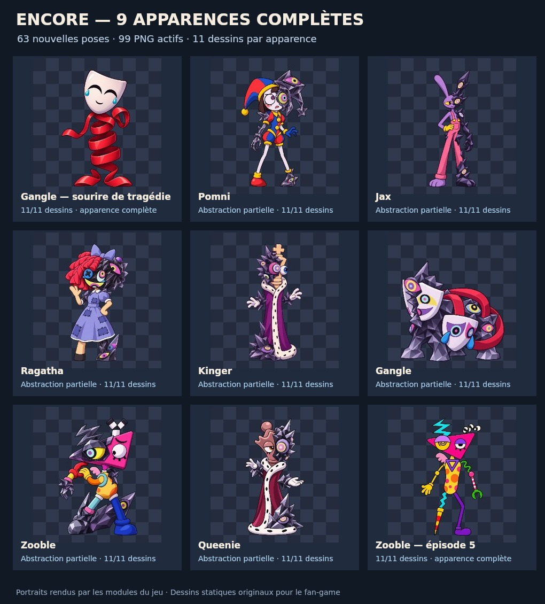

# Encore — les neuf apparences en attente sont complètes

**20 novembre 2026. Les 63 poses de la file de reprise ont été générées, revues et intégrées.** Les 36 dessins précédemment conservés rejoignent ces nouvelles poses : neuf apparences disposent maintenant de leurs onze fichiers distincts dans le jeu. Le checkpoint historique et ses 102 PNG acceptés restent inchangés.

[Voir la galerie](art-generation/cast-resumption-20261120/README.md) · [Inventaire complet et provenance](art-generation/cast-resumption-20261120/generation-completion.json) · [Vérifications](art-generation/cast-resumption-20261120/verification.json) · [PR #7](https://github.com/darknigthmare/CainOS/pull/7)

## Résultat de la génération

| Apparence | Dessins conservés | Nouvelles poses | Total actif |
| --- | ---: | ---: | ---: |
| Gangle — sourire de tragédie | 2 | 9 | 11/11 |
| Pomni — abstraction partielle | 2 | 9 | 11/11 |
| Jax — abstraction partielle | 3 | 8 | 11/11 |
| Ragatha — abstraction partielle | 3 | 8 | 11/11 |
| Kinger — abstraction partielle | 2 | 9 | 11/11 |
| Gangle — abstraction partielle | 5 | 6 | 11/11 |
| Zooble — abstraction partielle | 2 | 9 | 11/11 |
| Queenie — abstraction partielle | 9 | 2 | 11/11 |
| Zooble — assemblage de l’épisode 5, sans lunettes | 8 | 3 | 11/11 |
| **Total** | **36** | **63** | **99** |

Les onze emplacements sont `selection`, `stance`, `intro`, `attack`, `heavy`, `hit`, `walk`, `jump`, `crouch`, `victory` et `defeat`. Les 63 nouveaux PNG représentent **83 260 788 octets** ; les 99 fichiers nouvellement actifs représentent **135 453 941 octets**. Aucun emplacement de cette file ne reste à générer.

Chaque sortie acceptée provient de `image_gen.imagegen`. Le reçu individuel contient le prompt réellement envoyé, les références utilisées et leurs empreintes, le fichier source, le SHA-256 du PNG, ses dimensions, son alpha et les observations de revue. Les corrections ciblées gardent aussi le prompt initial. Pour la marche de Jax, l’interruption temporaire de l’environnement a laissé une image native dans `image_url` sans chemin ni identifiant de génération ; les octets PNG ont été conservés exactement, et le reçu indique honnêtement `sourceGenerationId: null`.

Les **huit essais natifs rejetés** sont archivés séparément et ne sont pas installés dans le jeu. Ils documentent notamment les corrections d’attribution des chaussures de Pomni, les membres opposés et les boutons de Jax, l’opposition des bras et des jambes pendant la marche de Ragatha, le raccord de main de Kinger et l’anneau de Zooble. Un premier appel pour la réaction de Zooble a été bloqué sans retourner d’image. Son reçu est conservé ; une autre pose, décrivant un déséquilibre neutre avec la seule sélection approuvée comme référence, a été acceptée et constitue le slot `hit` publié.

## Préservation et intégration

Les PNG natifs sont copiés à l’octet près. Il n’y a ni recadrage, ni retrait de fond après génération, ni normalisation de l’alpha, ni duplication d’une pose pour remplir un autre emplacement. Un maximum d’alpha natif de 254 reste 254. Les images acceptées possèdent une transparence réelle et leurs contours significatifs, au seuil `alpha >= 12`, restent dans le canevas.

L’[audit d’intégrité indépendant](art-generation/cast-resumption-20261120/native-integrity-audit.json) recalcule les empreintes et les bornes depuis les fichiers. Il vérifie les **63 nouvelles sorties**, les **102 images préexistantes**, les **99 copies actives**, les huit PNG rejetés et les références effectives. Les 165 dessins acceptés du plan du 20 novembre possèdent des SHA distincts. Trois bornes de métadonnées ont été corrigées d’un pixel pour correspondre exactement au seuil du chargeur ; les images n’ont pas été modifiées.

Le checkpoint gelé reste [generation-resume.json](art-generation/cast-continuation-20261120/generation-resume.json), avec le SHA-256 `2ca4585a5e30eba98e9f044e40d637ef38d5a52912c09890efb85d503985cbe9`. Son ancienne file de 63 poses décrit l’état avant reprise. Le nouveau [generation-completion.json](art-generation/cast-resumption-20261120/generation-completion.json) établit leur correspondance avec les fichiers acceptés et contient une file restante vide.

Les neuf définitions sont ajoutées après les quatorze apparences supplémentaires déjà publiées. Elles conservent leurs propriétaires, leurs références et leurs identifiants du plan initial. Elles apparaissent dans les sélecteurs existants et réutilisent les kits de leurs personnages. Les profils, campagnes et replays conservent la tenue sélectionnée ; le moteur de simulation et les formats de sauvegarde ne changent pas.

### Orientation particulière de Gangle abstrait

La créature cristalline `abstractinggangle` possède deux dessins orientés à droite, `intro` et `heavy`, et neuf slots orientés à gauche. Le chargeur conserve cette direction dans chaque frame ; le renderer la combine avec le côté du combattant. Les fichiers natifs restent intacts.

La revue a repéré puis corrigé une première attribution de cette table au mauvais Gangle. Une régression compare désormais les **99 orientations du runtime aux données relues des fichiers**. Une seconde [revue indépendante du runtime](art-generation/cast-resumption-20261120/runtime-direction-review.json) confirme cette correspondance. `smilingtragedygangle`, le personnage en rubans rouges au masque souriant, reste entièrement orienté à droite.

## Vérifications exécutées

| Contrôle | Résultat de cette passe |
| --- | --- |
| `npm run qa`, après correction d’orientation | **404 tests réussis**, zéro échec ; audits et contrôles de syntaxe réussis |
| Build CainOS | `dist/` construit |
| Build autonome | `dist-combat/` construit |
| Fichiers dans les deux distributions | **198 comparaisons SHA** pour les 99 PNG et **8 comparaisons de modules**, toutes conformes |
| Rendu Canvas de production via Node/Skia | **81 actions**, **9 gardes**, **9 portraits**, **180 contrôles des deux orientations**, aucun dessin manquant |
| Revue visuelle des planches | Neuf planches inspectées ; aucune silhouette coupée ni anomalie d’identité bloquante relevée |
| Navigateur local | **Bloqué avant navigation** : Chromium échoue sur `socket()`, permission refusée, puis `SIGABRT` |

Le [journal QA](art-generation/cast-resumption-20261120/qa.log), les [comparaisons des builds](art-generation/cast-resumption-20261120/build-integrity.json), les [rendus par famille](art-generation/cast-resumption-20261120/canvas-runs.json) et la [tentative navigateur](art-generation/cast-resumption-20261120/browser-attempt.json) consignent les exécutions réelles. Les neuf rendus ont tourné dans des processus séparés et séquentiels pour borner la mémoire native. Ils utilisent les modules du jeu, inspectent la source effectivement dessinée, le sens et l’échelle uniforme ; ils ne constituent pas une session navigateur.

Les poses de saut de Jax et Ragatha paraissent plus massives que leurs positions debout, car les silhouettes repliées sont ramenées à la hauteur de présentation du jeu. Les contours restent complets et l’échelle n’est pas étirée. Cette variation de taille perçue est consignée comme limite de continuité entre dessins statiques.

La CI distante du commit précédent `532315e6814ce6b48e4645204ecc96b7467bb5d0` a réussi, y compris sa suite navigateur. Ce résultat historique ne valide pas les nouvelles images ni le code ajouté ici : le commit portant cette reprise doit disposer de son propre résultat de CI. La PR reste en brouillon et n’est pas fusionnée par cette passe.

## État du catalogue après intégration

Les [compteurs calculés depuis le runtime](art-generation/cast-resumption-20261120/runtime-counts.json) donnent :

- **54 combattants**, 540 techniques, 22 arènes partagées et 179 entrées d’archives.
- **452 costumes sélectionnables**, dont **23 apparences Circus supplémentaires complètes** et leurs **253 PNG distincts**.
- **1 487 fichiers de personnages hors crossovers** : 1 152 actions, 128 gardes et 207 portraits.
- **5 590 images hors ligne**, pour **2 860 106 610 octets** ; version `0.7.0-19c3d66b967f`, art `f9d143077918e2e9`.

Ces variantes ne sont pas neuf nouveaux combattants : elles utilisent les identités et les techniques existantes. Les sept modèles d’abstraction partielle proviennent des produits officiels Abstraction Animiniz ; ils ne prouvent pas qu’une telle transformation est montrée dans un épisode. Le sourire de tragédie et l’assemblage de Zooble gardent leurs références d’épisodes indiquées dans les définitions et le checkpoint.

## Suivi restant

La génération de la file de 63 poses est terminée. Les animations image par image, la comparaison canonique scène par scène et les autres candidats encore sans conception suffisamment établie restent des travaux distincts.

Le classeur installé et ses trois fichiers compagnons restent identiques à la version préservée. L’export XLSX avait dépassé la mémoire disponible lors de la passe précédente ; il n’a pas été relancé ici. Le [checkpoint de récupération du classeur](art-generation/workbook-recovery-20261120/README.md) et le nouveau manifeste de génération permettent de préparer plus tard une publication atomique, incluant aussi les six accessoires de décor. Aucun JSON compagnon isolé n’a été publié pour faire croire à un classeur à jour.
