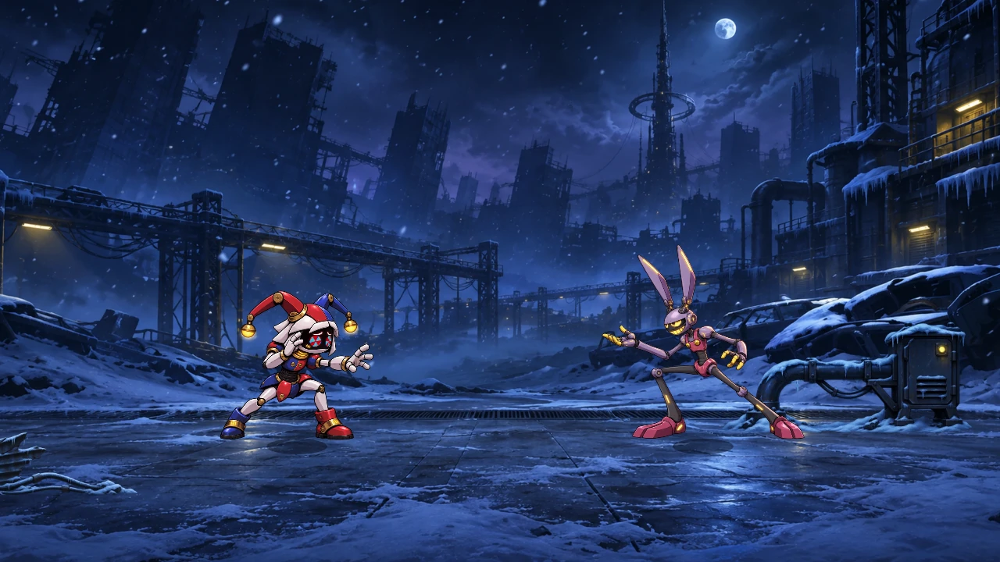
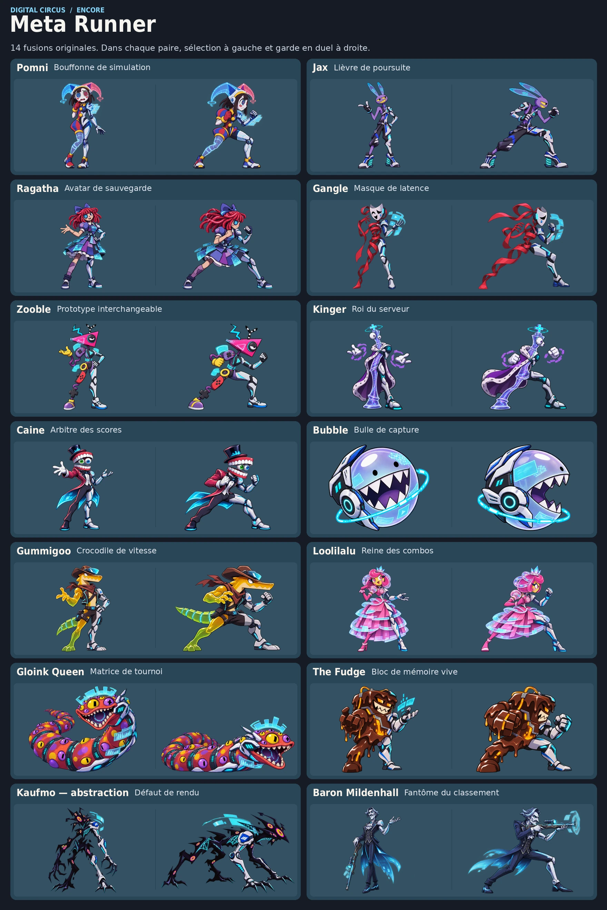
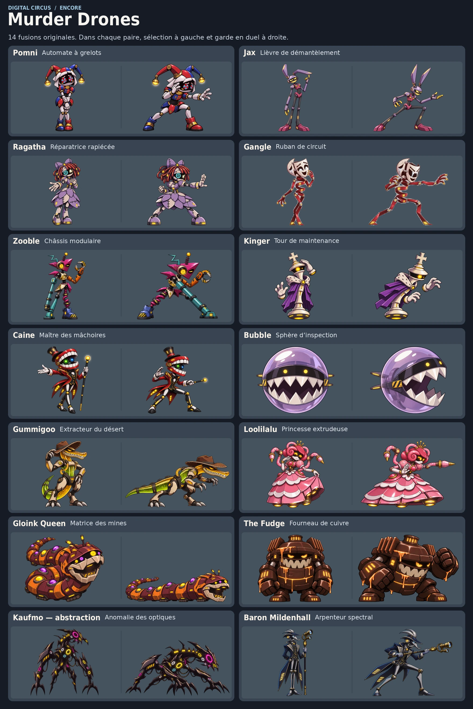
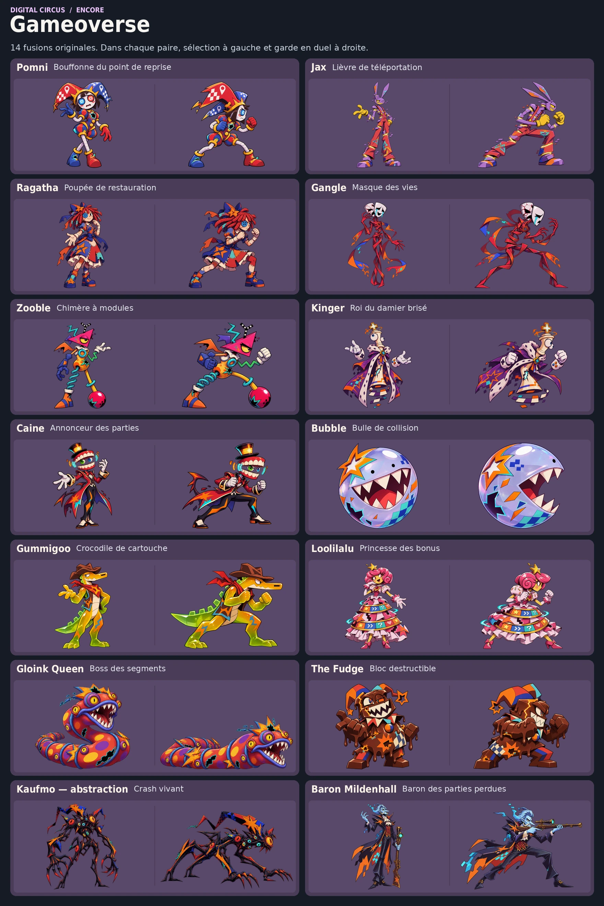
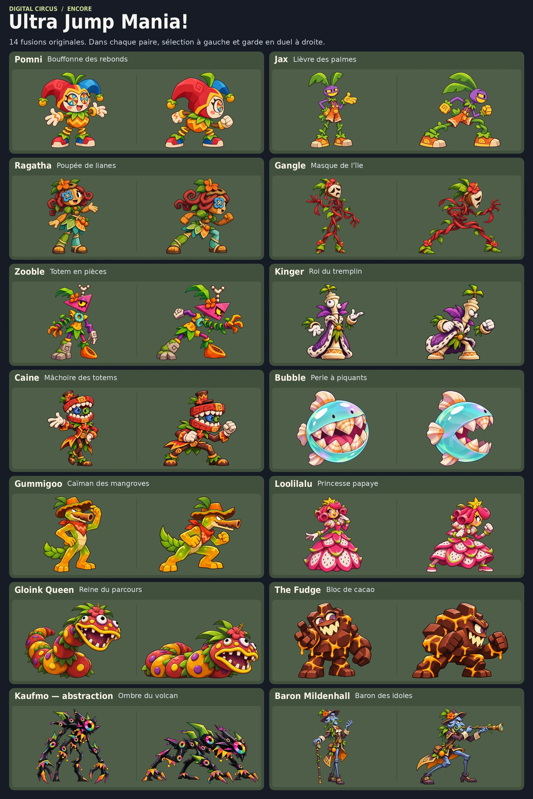

# Fusions originales des combattants

Chaque planche réunit les quatorze combattants d’Encore dans un même univers. Chaque paire présente à gauche le portrait de sélection et à droite la garde latérale utilisée en duel. Les deux vues sont disponibles individuellement dans le dossier du combattant.

## Meta Runner

[Ouvrir les sprites individuels de cet univers](../assets/encore/crossovers/metarunner/).

## Sunset Paradise

[Ouvrir les sprites individuels de cet univers](../assets/encore/crossovers/sunsetparadise/).

## Murder Drones

[Ouvrir les sprites individuels de cet univers](../assets/encore/crossovers/murderdrones/).

## The Gaslight District

[Ouvrir les sprites individuels de cet univers](../assets/encore/crossovers/gaslightdistrict/).

## Knights of Guinevere

[Ouvrir les sprites individuels de cet univers](../assets/encore/crossovers/knightsofguinevere/).

## Gameoverse

[Ouvrir les sprites individuels de cet univers](../assets/encore/crossovers/gameoverse/).

## Lackadaisy

[Ouvrir les sprites individuels de cet univers](../assets/encore/crossovers/lackadaisy/).

## SMG4

[Ouvrir les sprites individuels de cet univers](../assets/encore/crossovers/smg4/).

## Ultra Jump Mania!

[Ouvrir les sprites individuels de cet univers](../assets/encore/crossovers/ultrajumpmania/).
