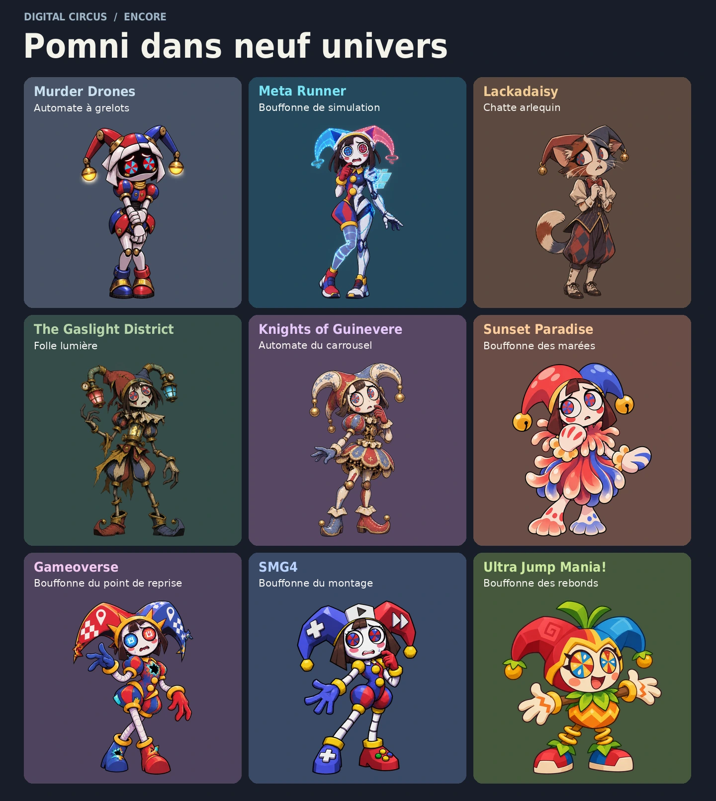
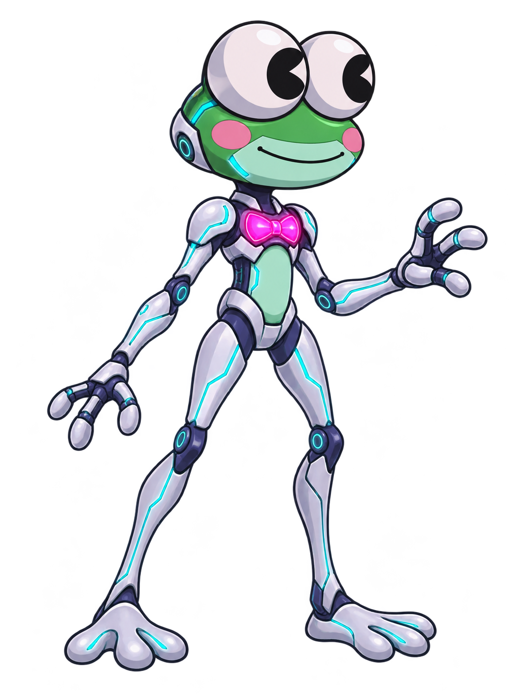
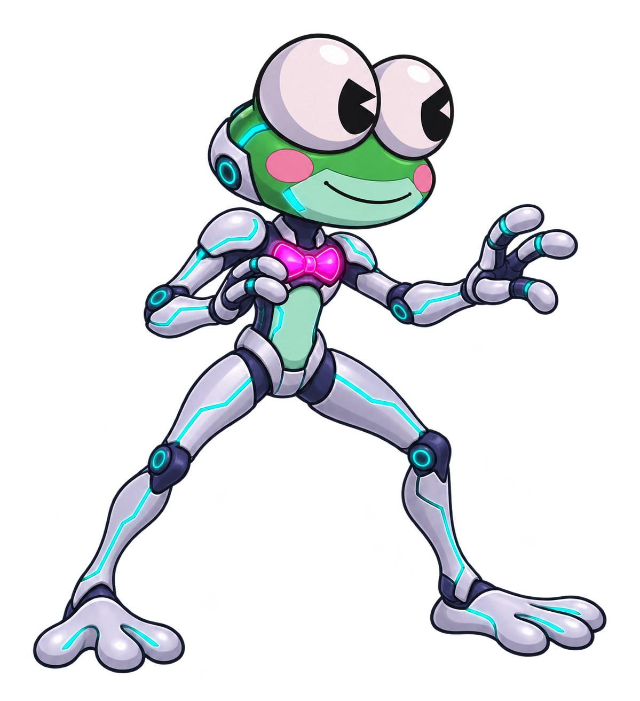
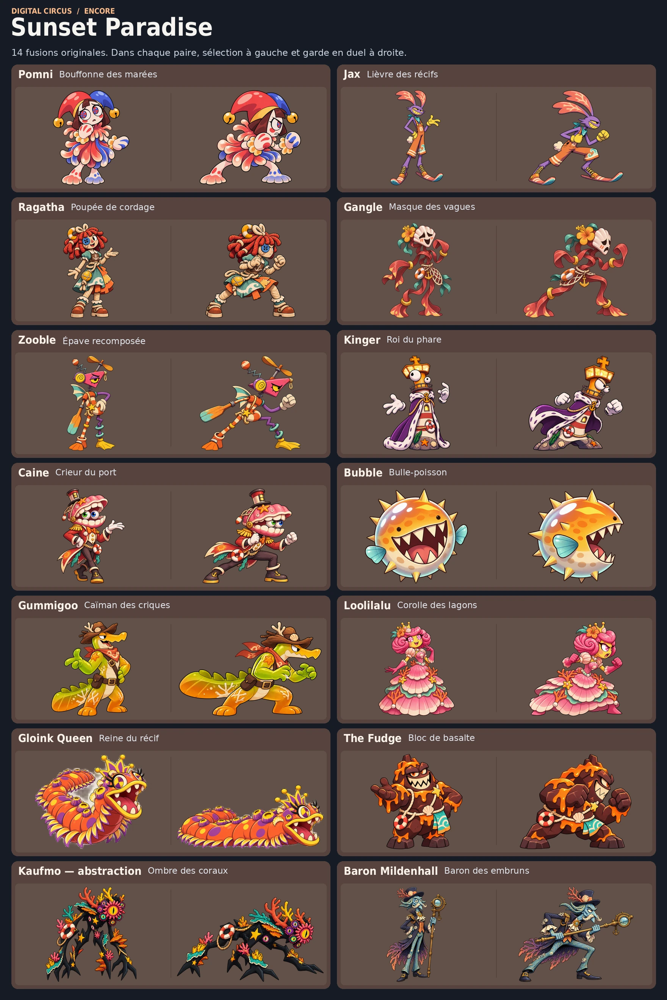
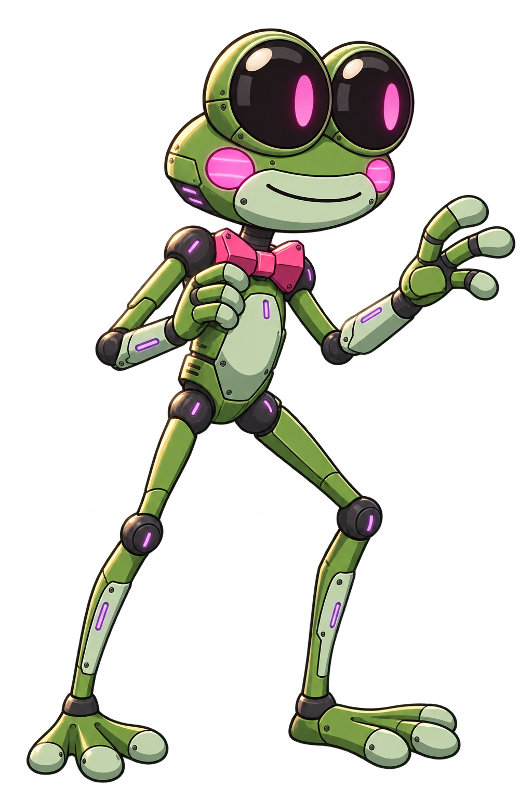
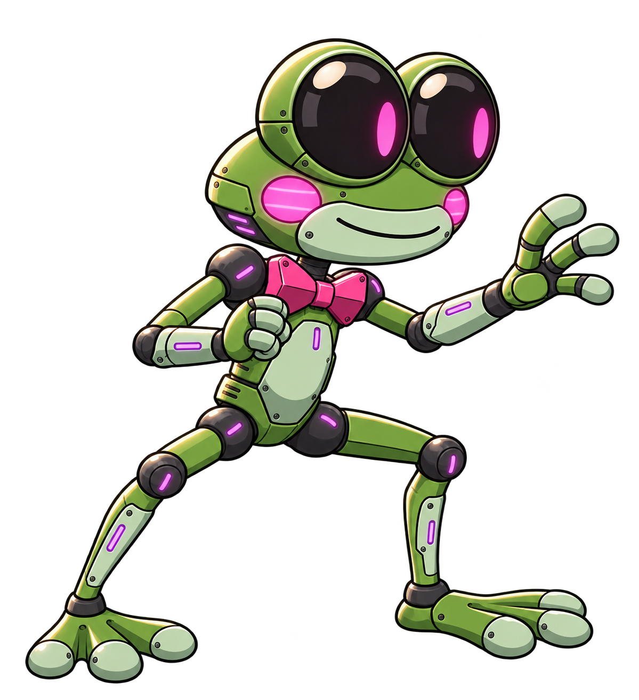
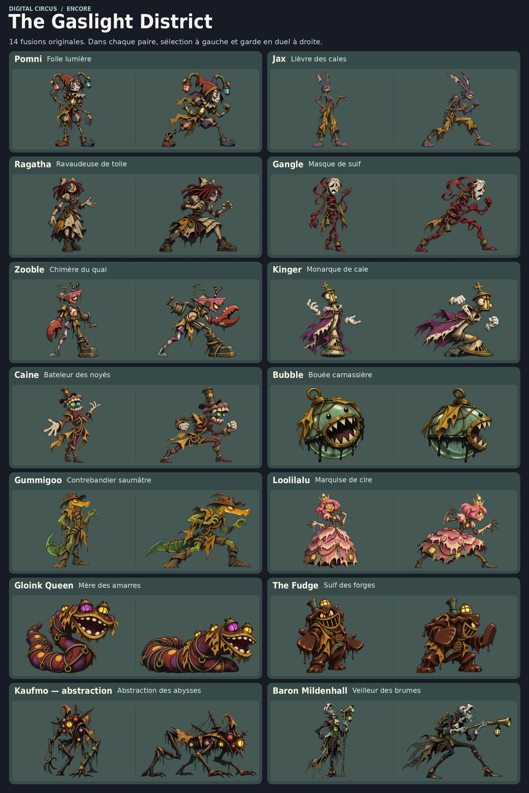
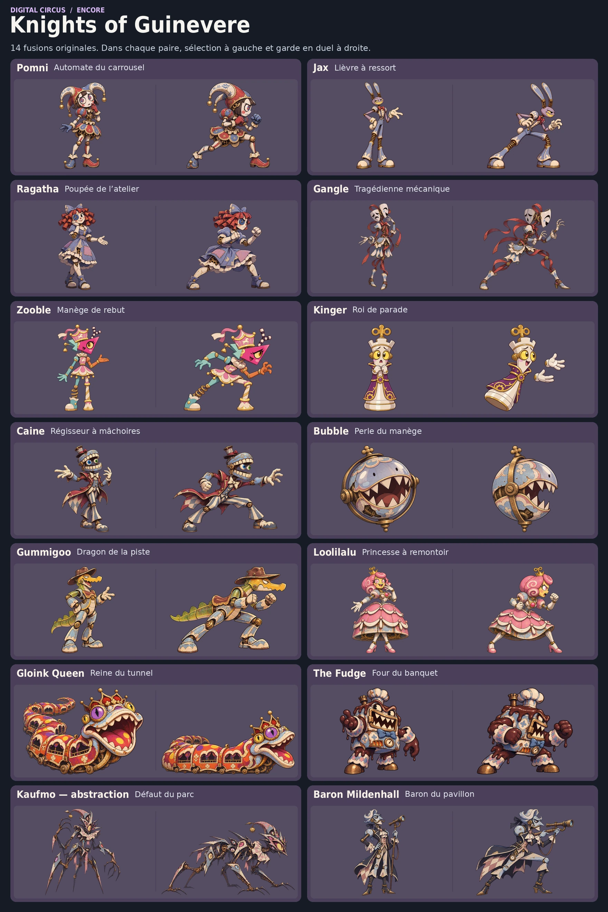
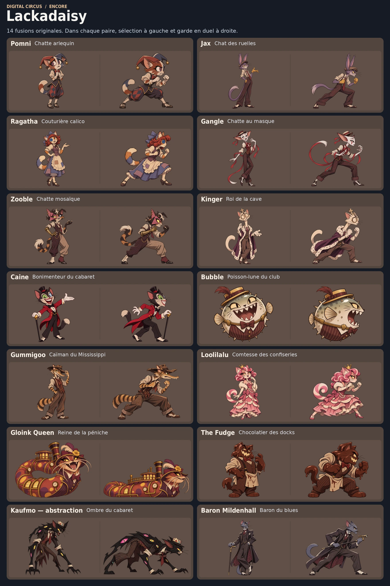
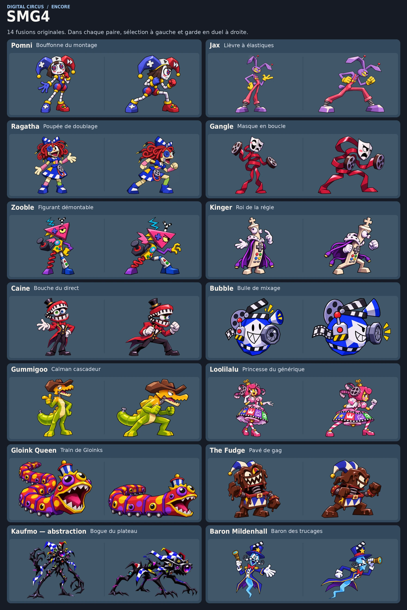

# Fusions originales des combattants

Les neuf planches historiques réunissent les quatorze propriétaires d’origine
dans chaque univers, soit **126 fusions originales**. Chaque paire présente à
gauche le portrait de sélection et à droite la garde latérale utilisée en duel.
Ces vues restent disponibles individuellement dans le dossier du combattant.

Le 20 novembre, **Ribbit · Automate amphibien** ajoute une fusion mécanique
Murder Drones, puis **Ribbit · Avatar de synchronisation** ajoute un corps
synthétique Meta Runner. Présentées séparément ci-dessous, elles portent le catalogue à
**128 fusions**, au sein des **384 crossovers / 3 847 fichiers**. Ribbit possède
les trois styles Murder Drones et Meta Runner, soit **6/27** sur les neuf collections ; les
39 autres PNJ promus n’ont pas encore de crossover. Les quatorze propriétaires
historiques conservent leurs neuf séries complètes.

Le [bilan courant](COMBAT_CONTINUATION_B_2026-11-20.md) et les
[galeries de production](art-generation/continuation-20261120-b/README.md) documentent
la dernière fusion avec Café Kinger, Café Pomni et le stade de softball. Le
[registre des manquants](art-generation/continuation-20261120-b/remaining-work.md) et le
[dossier du classeur](art-generation/continuation-20261120-b/workbook/README.md) conservent
les limites et les contrôles datés, sans transformer une pose statique en cycle animé.

## Meta Runner

### Ribbit · Avatar de synchronisation — ajout du 20 novembre

Cette fusion originale conserve la tête amphibienne expressive de Ribbit et
transforme tout son corps en avatar synthétique : plaques blanches et cyan pâle,
articulations marine, lignes lumineuses cyan et nœud magenta intégré au torse.
Les **onze PNG natifs** comprennent un portrait, une garde et neuf actions
distinctes, dont le coup lourd. Le kit, les statistiques et les règles de combat
restent ceux de Ribbit.

| Portrait de sélection | Garde latérale |
| --- | --- |
|  |  |

[Ouvrir les onze sprites de Ribbit](../assets/encore/crossovers/metarunner/ribbit/fusion/)
· [Comparer ses trois familles Meta Runner](COMBAT_CROSSOVERS_GLITCH.md#ribbit--meta-runner--trois-créations-originales).

### Les quatorze fusions historiques

[Ouvrir les sprites individuels de cet univers](../assets/encore/crossovers/metarunner/).

## Sunset Paradise

[Ouvrir les sprites individuels de cet univers](../assets/encore/crossovers/sunsetparadise/).

## Murder Drones

### Ribbit · Automate amphibien — ajout du 20 novembre

Cette fusion est une création originale du jeu : la silhouette mécanique conserve
l’identité de Ribbit dans un design inspiré de Murder Drones. Ses **onze PNG natifs**
couvrent sélection, garde et neuf actions distinctes, dont un coup lourd propre.
Ils utilisent le kit de Ribbit ; le design et les poses ne sont pas présentés comme
un costume canonique de la série.

| Portrait de sélection | Garde latérale |
| --- | --- |
|  |  |

[Ouvrir les onze sprites de Ribbit](../assets/encore/crossovers/murderdrones/ribbit/fusion/)
· [Comparer ses trois familles Murder Drones](COMBAT_CROSSOVERS_GLITCH.md#ribbit--premiers-crossovers-de-pnj-20-novembre).

### Les quatorze fusions historiques

[Ouvrir les sprites individuels de cet univers](../assets/encore/crossovers/murderdrones/).

## The Gaslight District

[Ouvrir les sprites individuels de cet univers](../assets/encore/crossovers/gaslightdistrict/).

## Knights of Guinevere

[Ouvrir les sprites individuels de cet univers](../assets/encore/crossovers/knightsofguinevere/).

## Gameoverse

[Ouvrir les sprites individuels de cet univers](../assets/encore/crossovers/gameoverse/).

## Lackadaisy

[Ouvrir les sprites individuels de cet univers](../assets/encore/crossovers/lackadaisy/).

## SMG4

[Ouvrir les sprites individuels de cet univers](../assets/encore/crossovers/smg4/).

## Ultra Jump Mania!

[Ouvrir les sprites individuels de cet univers](../assets/encore/crossovers/ultrajumpmania/).
