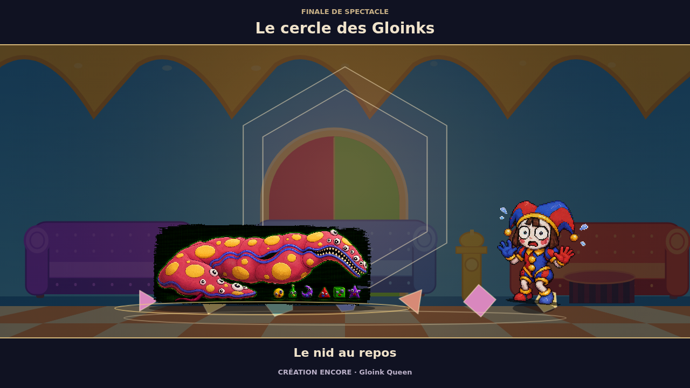
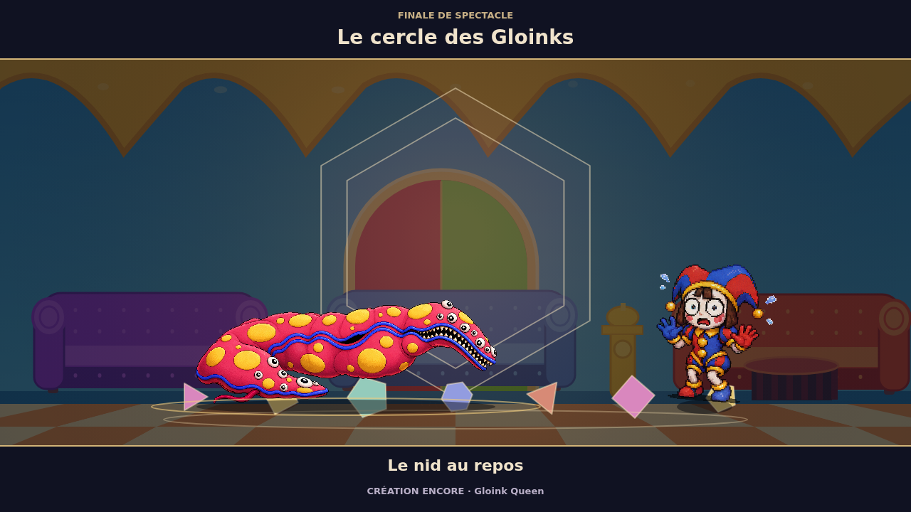

# Gloink Queen — transparence de l’apparence originale

## Défaut observé

La revue des finales 0.7 a montré un rectangle sombre autour de l’apparence
originale de Gloink Queen. Le sprite utilisait encore la planche RGB historique
`cainos-pixel-cast-sheet-gloink-queen-scale.png`. Le quadrillage opaque reliait
la reine aux petits Gloinks voisins : la sélection de la plus grande composante
ne pouvait pas isoler son corps.

La variante `gloinkqueenscale` utilisait déjà la planche RGBA isolée de la passe
0.6. Le défaut concernait l’apparence originale, également utilisée par les
portraits, les combats et la galerie.

## Correction

Le commit `1073ce21525c771f598b56d7452eaeceb2ed9178` applique le même
`COSTUME_SPRITE_OVERRIDES.gloinkqueenscale` à la définition du combattant dans
`combat/data.mjs`. Aucun nouveau dessin n’est créé.

Les identifiants, les 51 costumes, l’orientation `-1`, la sélection de la plus
grande composante et les dimensions visuelles **420 × 150** sont conservés.
Le corps de simulation reste **420 × 150**, avec une hauteur accroupie de **80**.
La correction n’ajoute aucune validation des proportions canoniques.

L’ancien PNG reste dans le dépôt. Il n’est plus nécessaire au pack de combat,
qui contient **44 planches / 52 167 739 octets** après reconstruction,
avec `ART_VERSION = 05a3fc712a39e1d8`.

## Vérification

Les trois finales ont été ouvertes par le vrai Codex, avec la tenue
**« Apparence originale »**, puis jouées jusqu’à leur terme. Les captures
confirment la disparition du rectangle noir, du quadrillage et des petits
Gloinks attachés. Le profil, le stockage, le replay et l’état du match sont
restés identiques ; aucune erreur console ou HTTP n’a été observée.

La régression ajoutée au test de fidélité existant échouait sur l’ancienne
source. Elle vérifie maintenant l’identité du sprite original et de la variante,
ainsi que les dimensions visuelles et de collision. Les **47 tests ciblés**
de fidélité, catalogue, règles/replays et rendu des finales réussissent.
Ces cas sont inclus dans la campagne complète ; ils ne s’y additionnent pas.

L’image « avant » a été conservée de la campagne précédant cette correction.
L’image « après » provient de la galerie corrigée. Elles montrent le dernier
tableau de la même finale super, avec la même apparence originale.

### Avant

### Après

