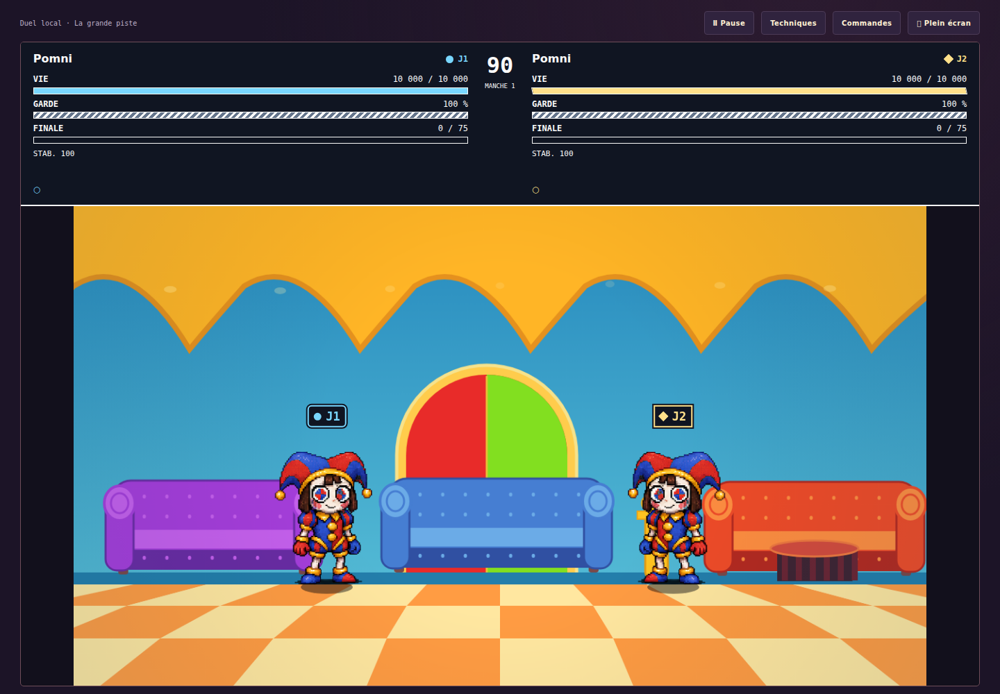
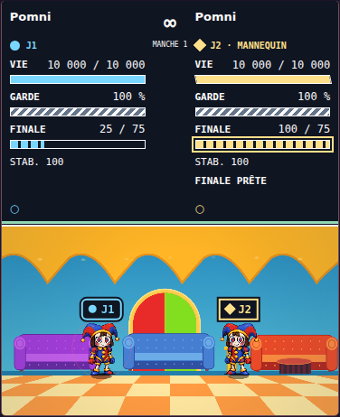

# Lisibilité, Archives et récupération hors ligne

Date : 29 octobre 2026. Projet : CainOS / Digital Circus — Encore 0.7.0.

**Cette passe est appliquée au jeu et vérifiée sur une campagne complète réussie.**
La référence retenue est GitHub Actions nº 40928776174 : 370 tests Node et
275 contrôles Chromium. Une campagne locale complète confirme indépendamment
les mêmes résultats. Le classeur est actualisé, recalculé, relu et réimporté ;
la livraison autonome utilise ce runtime et ces preuves.

- Base de la passe : `eab53bc0942fe0b23e3e2c5d191a187127a4e3d9`.
- Commit de code publié : `243e87b21b1e9eb8711e2012faf837f5850dae9a`.
- Revue : [PR nº 5 — CainOS](https://github.com/darknigthmare/CainOS/pull/5).

Les guides du snapshot décrit dans [GAMEDEV_WORKFLOW.md](GAMEDEV_WORKFLOW.md)
ont été appliqués aux API existantes : `game-ui-ux` pour les repères et le HUD,
`input-systems` pour la navigation et la saisie, `save-systems` pour les états de
préparation et de mise à jour hors ligne. Le principe de formes et de libellés
complétant la couleur suit également la
[recommandation Xbox Accessibility Guideline 103](https://learn.microsoft.com/en-us/xbox/accessibility/xbox-accessibility-guidelines/103).

## Changements appliqués

| Suivi | Comportement livré dans le code | Portée du statut |
| --- | --- | --- |
| PRE-12 / READ26-PLAYER-CUES | Option « Repères renforcés », conservée dans le profil. J1 porte un cercle, J2 un losange ; les libellés restent visibles même avec deux costumes identiques. Vie, Garde et Finale ont des noms, valeurs et remplissages distincts. | PRE-12 reste à traiter comme **Partiel** : joueurs et jauges sont couverts par cette passe ; la palette globale et les autres indicateurs restent ouverts. |
| CTL-08 / READ26-ARCHIVE-FOCUS | La recherche différée conserve la sélection de texte. Quitter Archives annule le rafraîchissement en attente. Un changement de filtre remplace la recherche différée. | Les défauts de navigation et de curseur sont corrigés ; le focus après Tab, déjà fonctionnel au départ, est protégé par un contrôle de non-régression. |
| INT-11 / READ26-OFFLINE-UPDATE | L’activation d’une mise à jour a une échéance de 20 secondes. Un échec ou un délai dépassé retire les écouteurs et termine la demande ; les appels simultanés partagent la même opération. | Un changement ultérieur de contrôleur ne provoque plus le rechargement abandonné. La réussite réelle est vérifiée par la suite navigateur. |
| INT-11 / READ26-OFFLINE-CACHE | Une préparation commencée revalide le pack. Après éviction puis erreur réseau, le statut reste incomplet jusqu’au téléchargement effectif des fichiers manquants. | Le réessai termine le pack, avec conservation du profil et des commandes personnalisées. |

Dans les réglages, ouvrir **Confort du spectacle**, puis activer **Repères
renforcés**. L’option est désactivée par défaut. Elle fonctionne au clavier et
survit au rechargement ainsi qu’à l’import d’un profil. Un ancien profil v1 qui
ne contient pas ce réglage garde ses données et le comportement par défaut.

Le HUD renforcé occupe un panneau opaque au-dessus de la scène. Les marqueurs
suivent les acteurs pendant les déplacements et les sauts ; ils sont masqués
pendant une scène de fin. Le retour au réglage désactivé restitue le HUD compact.
Les textes décrivent les valeurs du combat : « VIE CRITIQUE » au quart de vie ou
moins, « GARDE FRAGILE » à 25 points de garde ou moins, et un état de Finale qui
tient compte du seuil du personnage, de sa ressource et de son délai de
récupération. Une jauge chargée ne suffit pas à afficher « FINALE PRÊTE » si
l’action ne peut pas être utilisée.

## Défauts reproduits avant correction

| Cas | Observation sur la base de la passe | Résultat après correction |
| --- | --- | --- |
| Quitter Archives pendant une recherche | Saisir « Pomni », puis revenir à l’accueil avant le délai, réouvrait Archives après 250 ms. | Le rappel en attente est annulé lors de la sortie ; la navigation choisie reste affichée. |
| Modifier le milieu d’une recherche | Un curseur placé au caractère 1 revenait au caractère 5 après le nouveau rendu du champ. | Les bornes et le sens de la sélection sont conservés lorsque le champ garde le focus. Un focus déplacé par Tab n’est pas repris. |
| Abandonner une activation hors ligne | La reproduction Node exposait un rechargement encore armé après un échec d’activation. | La demande et ses écouteurs sont nettoyés ; les événements ultérieurs ne réactivent pas ce rechargement. |
| Réparer un pack après éviction | Dans Chromium, deux fichiers sont retirés du cache et une réponse HTTP 503 empêche la réparation complète. Le statut restait à tort complet. | Le navigateur indique 43 fichiers disponibles sur 44, puis retrouve l’état prêt après un réessai réussi. Le profil est préservé. |

Les deux reproductions Node initiales — activation et état du pack — passent de
**0/2 avant correction à 2/2 après correction**.

Le manifeste courant annonce **44 illustrations et 52 167 739 octets**, avec
l’identifiant `0.7.0-af4c13fc961f`. Le suivi INT-11 comportait une quantité
obsolète ; il est maintenant actualisé depuis les valeurs du manifeste.
Les 42 fichiers artificiels des fixtures Node servent uniquement à contrôler
les scénarios de test et ne décrivent pas le pack du jeu.

## Vérifications locales terminées

| Exécution | Résultat | Ce qu’elle établit |
| --- | --- | --- |
| `npm run qa` | **370/370 tests Node**, aucun échec ; audits et deux builds réussis | Vérifications du dépôt, guides, assets, contrats, syntaxe et génération des entrées CainOS et autonome. |
| `node --test tests/combat-readability.test.mjs` | **8/8** | Compatibilité du profil, seuils réels des jauges, absence de mutation des acteurs et identité des marqueurs. |
| `node tests/combat-readability-browser.mjs` | **14/14** dans Chromium 156.0.8078.73 | Archives, réglage au clavier, affichage des deux joueurs, déplacement et saut réels, plein écran, vie critique, Finale, petit écran et retour au HUD compact. |
| `node --test tests/combat-offline.test.mjs` | **20/20** | Activation bornée, refus et nettoyage, appels concurrents, progression et état réel de préparation. |
| `node tests/combat-offline-browser.mjs` | **13/13** | Éviction réelle de CacheStorage, erreur HTTP 503, réessai, rechargement à froid hors ligne et activation d’un worker par l’interface. |

Les 8 et 20 cas ciblés Node sont compris dans les 370 cas du dépôt. Les deux
reproductions offline recoupent la suite finale. Ces chiffres ne s’additionnent
pas comme des tests indépendants. Les 14 et 13 contrôles navigateur ci-dessus
sont deux suites ciblées locales, également incluses dans la campagne navigateur
complète retenue ci-dessous.

Les journaux, rapports et captures locaux sont conservés séparément des sorties
que la CI peut régénérer, dans `audit-combat/readability-local-20261029` et
`audit-combat/offline-local-20261029`. Les empreintes des sources et des artefacts
référencés ont été vérifiées. La preuve ciblée réconcilie ces
observations avec les mêmes sources du commit publié.

## Revue visuelle et déroulement des essais

La revue des captures finales couvre un bureau de **1 440 × 1 000 pixels**, le
plein écran et un viewport de **390 × 844 pixels**. Le HUD renforcé et la scène
entière tiennent ensemble sur le bureau et en plein écran, sans déformation de
la scène. À 390 pixels, les noms, valeurs et alertes restent visibles, sans
débordement horizontal. Le cercle J1 et le losange J2 restent distincts dans la
capture en niveaux de gris. Le HUD compact désactivé a également été relu.

Les captures retenues comprennent `mirror-desktop-viewport.png`,
`fullscreen-viewport.png`, `mirror-390px.png`, `mirror-390px-grayscale.png`,
`critical-life-desktop.png` et `default-desktop.png`. La mesure du contraste des
marqueurs donne environ **11,26:1 pour J1 et 14,13:1 pour J2** sur leur fond ;
elle ne constitue pas une mesure de toute l’interface. La vue en niveaux de gris
est un outil de revue interne, sans équivalence avec toutes les perceptions des
couleurs ni avec une étude utilisateur.

Captures issues du jeu sur les sources figées :

Trois tentatives de la nouvelle suite sont conservées avec la passe finale :

| Tentative | Point d’arrêt | Ajustement du test et limite de la conclusion |
| --- | --- | --- |
| 1 | 6 contrôles réussis avant l’assertion fullscreen | Le test examinait `fullscreenElement` avant la fin de la demande asynchrone. Il attend désormais cet état observable. |
| 2 | 7 contrôles réussis avant l’hypothèse de croisement | Le nouveau test supposait qu’un saut ordinaire permettait de franchir l’adversaire. Le point de départ a été rapproché pour examiner cette hypothèse. |
| 3 | 7 contrôles réussis, même hypothèse encore fausse | L’investigation a mesuré un saut d’environ 104,04 pixels pour un critère de séparation existant de 110 pixels. Le contrôle navigateur porte maintenant sur un déplacement et un saut réellement joués. |

La vérification de l’identité des joueurs à des coordonnées déjà croisées est
un test pur de présentation. Aucun franchissement joué n’est revendiqué et les
règles du combat n’ont pas été modifiées pour faire passer ces tests. La passe
finale de cette suite réussit ses quatorze contrôles.

## Campagne complète retenue

La [campagne GitHub Actions nº 40928776174](https://github.com/darknigthmare/CainOS/actions/runs/40928776174)
a réussi sur le commit `243e87b21b1e9eb8711e2012faf837f5850dae9a`.
Les audits, les tests Node et les deux builds ont réussi, puis le collecteur a
terminé les 27 suites Node et les 16 suites Chromium. Les **37 fichiers du runtime**
et toutes les sources de tests conservent leurs empreintes avant et après
exécution.

| Campagne | Node | Chromium | Rôle dans le suivi |
| --- | ---: | ---: | --- |
| GitHub Actions 40928776174 | 370/370 | 275/275 | Unique campagne complète retenue pour les 645 cas actuels. |
| Campagne locale, terminée le 29 octobre à 18:35:19 UTC | 370/370 | 275/275 | Confirmation indépendante sur les mêmes empreintes ; aucun cas ajouté aux totaux. |

La [preuve complète](combat-qa-evidence-readability-2026-10-29.json) conserve les
résultats réels, les identités des cas, les durées, les sources et les journaux.
La [preuve ciblée](readability-validation-2026-10-29.json) ajoute les reproductions
avant/après, les essais locaux, les captures relues et leurs limites. Ses quatre
groupes couvrent respectivement 18 cas de lisibilité, 4 de navigation Archives,
5 d’activation hors ligne et 4 de cache ; ils sont inclus dans la campagne
complète.

L’artefact CI nº `12922698873`, de **184 798 913 octets**, a été téléchargé et
vérifié intégralement par SHA-256 :
`1573c1860cdfe1251fdbcd3bdf1db4d08299895c66f90bf5aca7343be511c097`.
Les rapports, journaux et captures retenus ont ensuite été adoptés. La campagne
locale complète est conservée séparément ; ses résultats ne remplacent aucune
suite manquante de la campagne CI.

Cette CI du commit de code n’a pas publié de ZIP : son classeur était encore
celui de la passe précédente. Le conditionnement final intervient après la revue
du nouveau classeur, avec le contrôle strict décrit ci-dessous.

## Classeur actualisé et revu

Le [classeur](DIGITAL_CIRCUS_COMBAT_TRACKER.xlsx) conserve **10 feuilles,
9 tableaux natifs et 39 formules**, recalculées sans erreur et vérifiées après
export/réimport. Les statuts reflètent la portée réellement accomplie.

| Ensemble | Total | Répartition |
| --- | ---: | --- |
| Fonctionnalités | 105 | 84 implémentées, 7 partielles, 12 prévues, 2 à vérifier. |
| Production | 693 | 398 implémentées, 281 partielles, 14 prévues. |
| Scénarios | 85 | Registre conservé. |
| QA | 2 240 lignes | 2 236 réussies, 0 échec, 3 non exécutées, 1 à vérifier. |
| Campagne actuelle | 645 cas | 370 Node et 275 Chromium. |

**1 591 lignes QA protégées** restent strictement identiques : les 1 587 lignes
antérieures et les quatre objectifs audio/sauvegarde de la passe précédente.
Les **615 cas réexécutés** conservent leurs identifiants, leur ordre, leurs
critères et leurs notes ; seule leur preuve d’exécution est actualisée. La passe
ajoute **30 cas**, **quatre objectifs ciblés**, **quatre tâches de production** et
**une référence**. Les objectifs ciblés recoupent la campagne ; le nombre de
lignes QA ne mesure pas des tests indépendants.

La comparaison indépendante porte sur **39 742 cellules initiales**. Elle relève
exactement **625 changements de données prévus** : 615 preuves QA et 10 cellules
sur les trois fonctionnalités concernées. Aucun style initial ni aucune valeur
ou formule hors de ce périmètre n’a changé. Les largeurs, vues, fusions, volets
figés, validations et mises en forme conditionnelles initiales sont préservés.
Les neuf vues modifiées ont été relues.

Une seconde génération isolée termine avec zéro ajout et zéro modification.
Les données JSON sont identiques octet pour octet. La comparaison de **40 093
cellules** retrouve les mêmes valeurs, formules et styles résolus ; les neuf
parties XML des tableaux sont identiques. Certaines autres parties XML du XLSX
sont resérialisées : il s’agit d’une idempotence fonctionnelle et structurelle,
sans revendication d’identité binaire du fichier XLSX.

Voir la [vérification du classeur](combat-workbook-verification.json) et la
[revue indépendante](combat-workbook-readability-review-2026-10-29.json).
PRE-12 reste **Partiel** ; les trois essais non exécutés et la revue encore à
vérifier restent ouverts. Aucun Excel de bureau n’a été utilisé.

## Livraison autonome

Le conditionnement utilise `node scripts/package-combat-release.mjs` sans
l’option permettant de sauter une livraison en attente. Il exige la campagne
complète réussie, le classeur revu, les empreintes du runtime et des tests, ainsi
que les mêmes identités et nombres de cas.

Le ZIP réunit le jeu autonome, le classeur, les guides et rapports, les preuves
versionnées, les deux captures de lisibilité et les planches de finales. Le
contrôle de livraison compare les 37 fichiers du runtime, vérifie les copies
documentaires suivies et l’intégrité du ZIP. Le lanceur Python est analysé et
la syntaxe du lanceur POSIX est contrôlée.

Décompresser complètement `Digital_Circus_Encore_0.7.0.zip`, puis utiliser
`LANCER_ENCORE.cmd` sous Windows ou `sh LANCER_ENCORE.sh` sous macOS/Linux.
**Python 3 et un navigateur moderne sont nécessaires.** Le serveur utilise
l’adresse locale ; ouvrir directement `index.html` ne suffit pas à charger les
modules. Garder le même hôte et le même port conserve l’origine du profil.

`LIRE-MOI.txt`, `delivery-0.7.0.json` et **SHA256SUMS.txt**, fournis avec la
livraison, donnent les instructions, les contrôles effectifs et les empreintes
des fichiers remis. L’empreinte du ZIP reste extérieure au rapport contenu dans
ce même ZIP.

## Compatibilité et travaux ouverts

La version du jeu reste **0.7.0**, les règles de replay **0.5.0** et le profil
**v1**. La passe change la présentation, la navigation et la préparation hors
ligne. Les dessins, données d’attaques, règles de simulation et anciennes preuves
sont conservés.

PRE-12 reste partiel : palette globale, autres indicateurs et essais avec des
utilisateurs concernés sont encore ouverts. Cette passe ne valide ni lecteur
d’écran ni téléphone ou manette physiques. Les lanceurs n’ont pas été
essayés sur des machines Windows ou macOS dans cette passe. Le mixage sonore et la comparaison
artistique canonique restent des travaux distincts.
