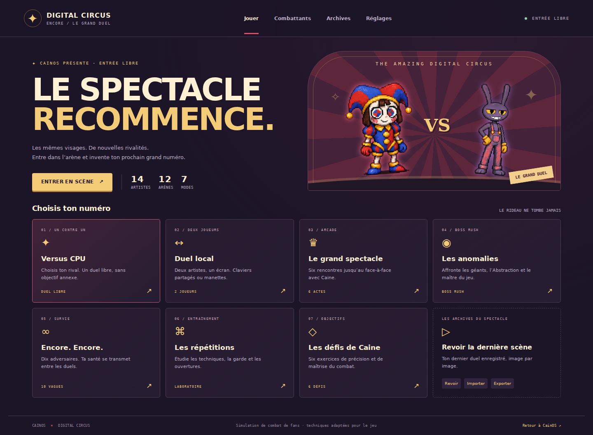

# Digital Circus — Encore · Le Grand Duel

Version jouable : **0.1.0** — 21 octobre 2026.



## Accès au jeu

L’icône **Circus Combat** et l’entrée correspondante du menu Démarrer ouvrent
`combat/index.html?embedded=1` dans une fenêtre de CainOS. Le lien « Ouvrir le jeu
autonome » lance le même module directement. La calibration de première utilisation
de CainOS est conservée ; le jeu autonome est accessible sans passer par ce prologue.

La fermeture, la réduction, le changement de fenêtre, la perte de focus, le masquage
de l’onglet et l’extinction du moniteur suspendent la rencontre. La reprise est
explicite. Le jeu autonome et la fenêtre intégrée utilisent le même moteur, les
mêmes définitions de contenu et le même profil local sur une origine commune.

## Construire les deux distributions

```bash
npm run build
npm run build:combat
```

`dist/` contient CainOS et son application de combat. `dist-combat/` contient le jeu
autonome, son point d’entrée et les 42 planches nécessaires aux combattants et aux
archives. Ce second dossier peut être hébergé indépendamment de CainOS.

Pour un essai local sans dépendance supplémentaire :

```bash
python3 -m http.server 8080 --directory dist-combat
```

Ouvrir `http://localhost:8080/`. Les modules JavaScript sont servis par HTTP ; une
ouverture directe en `file://` ne constitue pas un lancement pris en charge.
Le standalone livré est une application de navigateur autonome. Les paquets natifs
Windows/Linux et l’installation mobile complète sont suivis dans l’Excel.

## Contenu jouable

| Artiste | Fonction de combat | Exemple de mécanique adaptée |
| --- | --- | --- |
| Pomni | Esquive et mobilité | Glissade, recul numérique, ruée vers une fausse sortie |
| Jax | Pièges et provocation | Clef qui revient, piège au sol, provocation |
| Ragatha | Résistance | Parade de contact, armure temporaire, soin récupérable |
| Gangle | Portée | Rubans, ralentissement, protection contre un projectile |
| Zooble | Polyvalence | Pièces détachées, extension modulaire, parade |
| Kinger | Défense | Salve virtuelle, fort de coussins, contre |
| Caine | Contrôle de l’espace | Portails, téléportation et projections numériques |
| Bubble | Mobilité | Rebond, morsure et projectiles |
| Gummigoo | Pression | Avancée, attaques de contact et couverture |
| Loolilalu | Projectiles | Sceptre, éclats et barrières de sucre |
| Gloink Queen | Colosse | Gloinks, charge et carapace temporaire |
| The Fudge | Colosse | Projectiles lents, ralentissement au sol et absorption |
| Kaufmo abstrait | Menace | Projections de glitch, tentacules et charge |
| Baron Mildenhall | Précision | Projectiles, préparation et contrôle de distance |

Chaque combattant possède les dix emplacements CQC : léger, fort, bas, saisie,
spécial neutre, spécial bas, spécial avant, spécial arrière, finale et utilitaire.
Les 140 techniques sont décrites dans le codex et dans le classeur avec leurs
frames de démarrage, d’activité et de récupération, leurs dégâts, leurs portées,
leurs coûts et leur effet.

Les 12 décors sont la grande piste, Candy Canyon, Mildenhall Manor, Spudsy’s, le
cellier, le Vide, le lac numérique, la salle de calibration, le nid des Gloinks,
le palais de sucre, les terrains du cirque et le couloir des portes. Les arènes
partagent une surface de duel sans danger aléatoire. Les décors ont une géométrie
dessinée dans Canvas et une palette propre.

Les 74 variantes sélectionnables remplacent l’apparence du combattant sans modifier
son kit. Elles viennent des archives du projet ; leur présence n’atteste pas leur
statut canonique. Les 179 entrées d’archive sont recherchables et filtrables. Une
apparition inventoriée peut rester un personnage à adapter plutôt qu’un combattant.

### Modes

| Mode | Comportement livré |
| --- | --- |
| Versus CPU | Choix libre du personnage, du rival, des costumes, de l’arène et de la difficulté |
| Duel local | Deux joueurs simultanés au clavier partagé ou via l’API Gamepad |
| Le grand spectacle | Programme arcade de six rencontres ; dernier adversaire Caine |
| Les anomalies | Quatre rencontres de boss : reine, Fudge, Kaufmo abstrait, Caine |
| Encore. Encore. | Dix vagues ; santé conservée avec 1 200 points récupérés après une victoire |
| Les répétitions | Mannequin immobile, garde haute/basse, saut, réaction après impact ou CPU ; soin, finale libre, hitboxes et remise en place |
| Les défis de Caine | Six exercices mesurables de 60 secondes : dégâts, garde, combo, saisies, quatre techniques, finale |

Les duels libres respectent les réglages de manches gagnantes et de durée. Les
rencontres des programmes arcade, boss et survie sont en une manche gagnante.
Les victoires et les défis accomplis sont enregistrés dans le profil. Le multijoueur
réseau, les équipes/tag, les campagnes scénarisées, les tournois à tableau et les
finishers cinématiques figurent dans le plan de production.

## Commandes

| Action | Joueur 1 | Joueur 2 |
| --- | --- | --- |
| Déplacement | ZQSD en AZERTY, WASD en QWERTY, positions physiques identiques | Flèches |
| Saut | Haut ou Espace | Flèche haut |
| Léger / fort | J / K | B / N ou pavé 1 / 2 |
| Bas | Bas + J | Bas + B ou pavé 1 |
| Saisie / déchope | U | V ou pavé 4 |
| Spécial | I, avec direction éventuelle | Virgule (AZERTY), M (QWERTY) ou pavé 5, avec direction |
| Finale | O | Point-virgule (AZERTY), virgule (QWERTY) ou pavé 6 |
| Utilitaire | L | Deux-points (AZERTY), point (QWERTY) ou pavé 3 |
| Garde | Maj gauche | Maj droite ou pavé 0 |
| Dash | E | Ctrl droite ou décimale du pavé |
| Pause | Échap ou bouton visible | Échap ou bouton visible |

Les spéciaux avant/arrière sont relatifs à l’orientation face au rival. Une garde
haute laisse passer les coups bas et les saisies. Les annulations léger → fort,
bas → spécial et fort → spécial avant exigent un impact confirmé. Une finale
demande la jauge indiquée sur sa fiche ; certaines coûtent plus que les 75 % de base.

Manettes standard : stick/croix pour le déplacement, A/× pour sauter, X/□ pour le
léger, Y/△ pour le fort, B/○ pour le spécial, LB/L1 pour garder, RB/R1 pour saisir,
RT/R2 pour le dash, L3 pour la finale, R3 pour l’utilitaire et Start/Options pour la
pause. Les contrôles tactiles peuvent être forcés depuis les réglages. La validation
sur de vraies manettes et de vrais appareils mobiles reste distincte de l’émulation
Chromium et des simulations de l’API.

## Sauvegardes et replays

Le profil est versionné sous `cainos.circus-combat.profile.v1`. Le dernier replay
est enregistré séparément sous `cainos.circus-combat.replay.v1`. Les sauvegardes de
CainOS et de CQC ne sont ni remplacées ni migrées.

Les réglages, résultats, défis et médailles peuvent être exportés/importés en JSON.
Un import vérifie le format, les types et les limites ; le remplacement du profil
demande confirmation dans l’interface du jeu. Un stockage local bloqué ne doit pas
empêcher de jouer : le jeu conserve sa session et signale la nécessité d’exporter.

Un replay contient le couple de combattants, l’arène, la graine, les règles, la santé
initiale et les commandes compressées par séquences identiques. L’IA reste
déterministe. La lecture reproduit une simulation à 60 Hz et n’ajoute aucun résultat
au palmarès. La compatibilité est liée à la version du jeu. La capacité est bornée
à 72 000 images, soit 20 minutes de simulation ; les pauses ne sont pas enregistrées.

## Provenance du moteur

La base CainOS est le commit
[`4926834a2f063028903d6431e77f0bece859e671`](https://github.com/darknigthmare/CainOS/commit/4926834a2f063028903d6431e77f0bece859e671)
de `main`.

La référence CQC est le commit
[`42279c1c884769873e66bbda0b6fe849bcd2f1a2`](https://github.com/darknigthmare/shadow-codec-ops/tree/42279c1c884769873e66bbda0b6fe849bcd2f1a2/public/cqc)
de la branche `codex/cqc-p38-archive-projectile-range`, contenant la fusion de la
garde-robe P39. La branche `main` du projet Metal Gear était plus ancienne.

Le module `combat/engine.mjs` porte réellement le noyau `CQCCombat046` embarqué
dans `public/cqc/modules/unified-versus-v055.html`, avec le corps de simulation du
fichier actif `public/cqc/src/cqc-pass8-combat-engine.js` et la correction de délai
CPU de `cqc-pass10-cpu-ai.js`. L’enveloppe ES module isole le moteur des globals CQC
et des contenus Metal Gear.

Sont conservés : pas fixe 60 Hz, dix emplacements de coups, startup/active/recovery,
garde et chip non létal, brisure, projections/déchopes, parades/reflets limités,
combos avec dégradation et échappement, coûts, ressources, pièges, effets d’état,
collisions balayées des projectiles et hasard xorshift32.

Les corrections ajoutées pendant le port concernent notamment la garde maintenue
pendant le blockstun, une annulation refusée qui ne supprime plus la récupération,
la fenêtre de déchope, le dash arrière, la comparaison de pourcentages de santé à
la limite de temps et la portée effectivement bornée des projectiles.

Les noms et apparences proviennent de CainOS et des références GLITCH listées dans
`combat/data.mjs`. Les techniques et les rencontres sont des adaptations de jeu.
Les archives tardives ou spéculatives de CainOS restent signalées comme éléments du
projet à vérifier. L’Excel les inventorie sans convertir automatiquement leurs
anciens libellés en faits canoniques.

## Architecture des fichiers

| Fichier | Responsabilité |
| --- | --- |
| `combat/engine.mjs` | Simulation indépendante du navigateur et enveloppe fixe |
| `combat/data.mjs` | Combattants, kits, arènes, sources et variantes |
| `combat/sprite-catalog.mjs` | Inventaire des atlas dérivé des tables CainOS |
| `combat/render.mjs` | Rendu Canvas, extraction/cadrage en cache, effets, décors |
| `combat/input.mjs` | Clavier, tactile, manette et impulsions de commandes |
| `combat/session.mjs` | Profils, replays, programmes, défis et compteurs testables |
| `combat/app.mjs` | Menus, sélection, parcours, résultats et liaison avec l’OS |
| `scripts/build-combat.mjs` | Distribution statique indépendante |
| `scripts/build-combat-catalog.mjs` | Extraction reproductible du catalogue CainOS |
| `scripts/build-combat-workbook.mjs` | Génération du classeur et de ses données à partir des définitions livrées |
| `docs/DIGITAL_CIRCUS_COMBAT_TRACKER.xlsx` | Classeur de production filtrable et éditable |

## Vérifications et limites pratiques

`npm run qa` exécute les audits CainOS existants, les tests comportementaux du
moteur et de la session, les vérifications de syntaxe et les deux assemblages.
Les cas couvrent les 140 techniques, tous les combattants, les collisions, les
coûts, les combos, les transitions de manches, le déterminisme, les sauvegardes et
les défis. Les résultats détaillés sont consignés dans le suivi QA et les rapports.

La validation de cette livraison a réussi les **40 tests moteur et 23 tests
session/commandes**. Les essais Chromium ont réussi **11 parcours d’interface et
d’intégration, 9 vérifications de progression/replay/standalone, puis une régression
ciblée** sur la progression sans stockage et les dialogues de résultat après Échap.
Ces dernières corrections ont été revérifiées dans leur périmètre ; la suite complète
de progression comporte désormais dix vérifications à sa prochaine exécution.
Les assertions exécutées et leurs limites sont conservées dans
[`combat-qa-evidence.json`](combat-qa-evidence.json).

Les parcours navigateur sont reproductibles avec Playwright et Chromium :

```bash
# Avec Playwright et Chromium disponibles dans l'environnement :
python3 -m http.server 4178
COMBAT_TEST_URL=http://127.0.0.1:4178 node tests/combat-browser.mjs
COMBAT_TEST_URL=http://127.0.0.1:4178 node tests/combat-progression-browser.mjs
```

`PLAYWRIGHT_CHROMIUM_EXECUTABLE_PATH` permet de choisir un exécutable Chromium
existant. Les scripts n’injectent pas de commandes privées dans le moteur ; ils
utilisent l’interface publique, les commandes et une vue de lecture de l’état.

Les sept planches animées du projet servent aux poses de repos, de marche,
d’interaction et de blessure. La pose d’interaction est réutilisée pour les attaques.
Les autres personnages et les costumes utilisent des sprites avec transformations
procédurales. Des animations de combat dessinées, des portraits finaux, une bande
son complète, un équilibrage compétitif et les contenus étendus sont encore à
produire. Ces besoins figurent comme partiels ou prévus dans le classeur.

Les contrôles à 390 px vérifient une fenêtre tactile émulée ; ils ne valent pas
certification sur téléphone physique. De même, les routes testées et les résultats
automatisés ne constituent pas une certification commerciale de toute la production.
