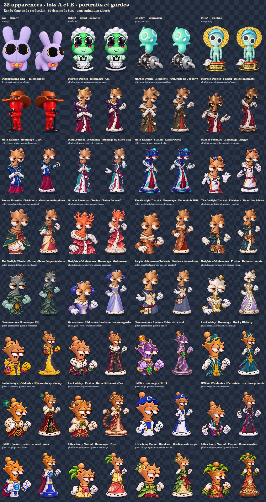

# Sprites de base — reprise et complétion du 25 novembre 2026

Cette livraison réunit **72 PNG distincts** dans le moteur partagé de CainOS et
Digital Circus — Encore : **32 apparences avec portrait et garde**, puis
**huit motifs de projectile individuels**. Les fichiers représentent
**95 506 966 octets**. Chaque PNG installé a été comparé à sa sortie native de
génération retrouvée : 72 correspondances exactes, sans retouche des pixels.

## Ce qui était local et ce qui a été produit

| Origine | Personnages | Projectiles | Total |
| --- | ---: | ---: | ---: |
| Lot A récupéré, absent du commit publié de départ | 28 | 4 | 32 |
| Début du lot B récupéré | 7 gardes | 4 | 11 |
| Complétion de cette session | 18 portraits et 11 gardes | 0 | 29 |
| **Total intégré** | **64** | **8** | **72** |

Le point de départ distant est `616a585274506f20c54386d8be07a76e75e1f198`,
avec 508 costumes. Le lot A était entièrement dessiné mais encore local ;
la continuation B comportait quatre projectiles et sept gardes non exposées
dans la garde-robe. La reprise conserve ces **43 images** et complète leurs
manques. Les images récupérées ne sont pas comptées comme de nouvelles
générations de cette session.

## Contenu des 32 apparences

| Collection | Apparences | PNG |
| --- | --- | ---: |
| Références de produits officiels | Bunny Jax, Maid Ribbit Pendantz, Ghostly avec aspirateur, Ming avec trophée, Disappearing Guy avec microphone | 10 |
| Queenie × Murder Drones | Hommage Uzi, Archiviste de Copper-9, Reine automate | 6 |
| Queenie × Meta Runner | Hommage Tari, Stratège de Silica City, Avatar royal | 6 |
| Queenie × Sunset Paradise | Hommage Meggy, Gardienne du phare, Reine du récif | 6 |
| Queenie × The Gaslight District | Hommage Melancholy Hill, Dame des écluses, Reine des profondeurs | 6 |
| Queenie × Knights of Guinevere | Hommage Guinevere, Gardienne des coulisses, Reine automate | 6 |
| Queenie × Gameoverse | Hommage Kit, Gardienne des sauvegardes, Reine de cristal | 6 |
| Queenie × Lackadaisy | Hommage Rocky Rickaby, Hôtesse du speakeasy, Reine féline art déco | 6 |
| Queenie × SMG4 | Hommage SMG4, Réalisatrice des Showgrounds, Reine de machinima | 6 |
| Queenie × Ultra Jump Mania | Hommage Theo, Gardienne du verger, Reine cocotier | 6 |

Les 27 crossovers de Queenie sont des **créations originales Encore**. Les
références guident son identité et le vocabulaire des univers ; ces apparences
ne sont pas présentées comme des costumes officiels. Les cinq variantes issues
de produits officiels adaptent les compositions visibles documentées dans
le [dossier du lot A](../base-sprites-20261125/official/README.md).

Les huit motifs ajoutés couvrent Queenie, Ribbit, Kaufmo, Ming, Ghostly,
Orbsman, l’Huître et Abel. Leurs dessins sont des adaptations de combat
originales, sans nouveau pouvoir canonique revendiqué.

## Intégration au jeu

La garde-robe atteint **540 costumes**, dont **432 crossovers**. Queenie possède
maintenant ses 27 paires de base, à l’instar de Ribbit. Les 64 combattants,
640 techniques, 27 arènes partagées et neuf arènes crossover conservent leur
nombre et leurs règles.

Le contrat `baseOnly` expose seulement `selection.png` et `stance.png`.
Le portrait est utilisé dans la sélection ; la même garde accompagne les
états du combat avec l’échelle, l’ancrage et l’orientation du moteur existant.
Les collisions et les techniques ne sont pas dérivées du dessin. L’intégration
ne crée aucune animation ni pose d’action supplémentaire.

Les huit motifs dédiés gardent un mouvement graphique `fixed`. Leur déplacement
et leur renvoi suivent les règles existantes. Les 15 motifs historiques restent
présents, soit **23 motifs** au total.

Le module B est généré par
[`install-combat-base-continuation-20261125-b.py`](../../../scripts/install-combat-base-continuation-20261125-b.py)
à partir des 36 PNG et des revues explicites de leurs empreintes. Une paire
incomplète ou modifiée après revue empêche l’installation. Le manifeste hors
ligne a été régénéré par le script du projet : **`0.7.0-1a9ef920f4fe`**,
art **`c3a873743de8943b`**.

## Vérifications exécutées sur cette source

| Contrôle | Résultat |
| --- | ---: |
| `npm run qa`, tests Node | **469 réussis**, 0 échec, 0 ignoré |
| Build CainOS normal, comparaison SHA-256 | **6 274 fichiers identiques**, 0 différence |
| Build autonome normal, comparaison SHA-256 | **6 270 fichiers identiques**, 0 différence |
| Illustrations dans chacun des deux builds | **6 202** |
| Fichiers du moteur dans chacun des builds | **66** |
| Sources natives des 72 nouveaux chemins | **72 copies identiques** |
| Assets suivis avant la reprise | **6 134 inchangés** |
| Préfixes des catalogues | **508 puis 522 costumes préservés exactement** |
| Canvas des 32 apparences | **640 contrôles, 1 920 dessins**, 32 feuilles inspectées |
| Canvas des 23 projectiles | **46 tirs, 44 renvois, 90 contrôles** |

Les sorties de build ont été produites successivement dans le même dossier
temporaire, comparées aux sources puis supprimées après conservation des
rapports. Le collecteur Canvas a rencontré un disque plein après 28 familles ;
sa reprise a vérifié les empreintes des sources et des PNG déjà rendus, produit
les quatre dernières familles et redécodé les 32 feuilles pour l’aperçu.

### Preuves

- [Vérification consolidée](verification.json)
- [Inventaire des 72 PNG](asset-inventory.json)
- [Conservation des assets précédents](prior-assets-preservation.json)
- [Conservation des deux préfixes de catalogue](catalog-preservation.json)
- [Build CainOS](build-cainos.json) et [build autonome](build-standalone.json)
- [Rendu actuel des 32 apparences](canvas-all/base-canvas-review.json) et [revue visuelle](canvas-all/visual-review.json)
- [Rendu actuel des projectiles](canvas-projectiles-current/projectile-canvas-review.json) et [revue visuelle](canvas-projectiles-current/visual-review.json)
- [Classeur mis à jour et contrôle de conservation](workbook/README.md)
- [Prompts et revues Gaslight / Knights](completion-gaslight-knights/README.md)
- [Prompts et revues Gameoverse / SMG4](completion-gameoverse-smg4/README.md)
- [Prompts et reçus Lackadaisy / Ultra Jump Mania](completion-lackadaisy-ultra/manifest.json)

## Limites maintenues visibles

Le wrapper Chromium présent dans l’environnement ne possède pas son binaire.
**Aucune assertion navigateur locale** n’est déclarée. La campagne GitHub Actions
doit être lue sur le SHA de publication ; les résultats d’un ancien commit ne
valident pas celui-ci.

Le texte du trophée de Ming s’inverse avec la garde gauche, conformément au
miroir intégral. La traînée de Bubble reste dessinée par le moteur et visible
dans la partie transparente du motif. Aucun défaut bloquant n’a été relevé dans
les captures de cette passe.

L’objectif de fidélité des références est conservé ; la présence d’un PNG ou le
succès des tests ne constitue pas une certification canonique ou pixel à pixel
1:1. Les créations originales, références masquées, éventuels cycles animés et
essais sur appareils physiques restent distingués dans le
[registre des travaux ouverts](remaining-work.md).

