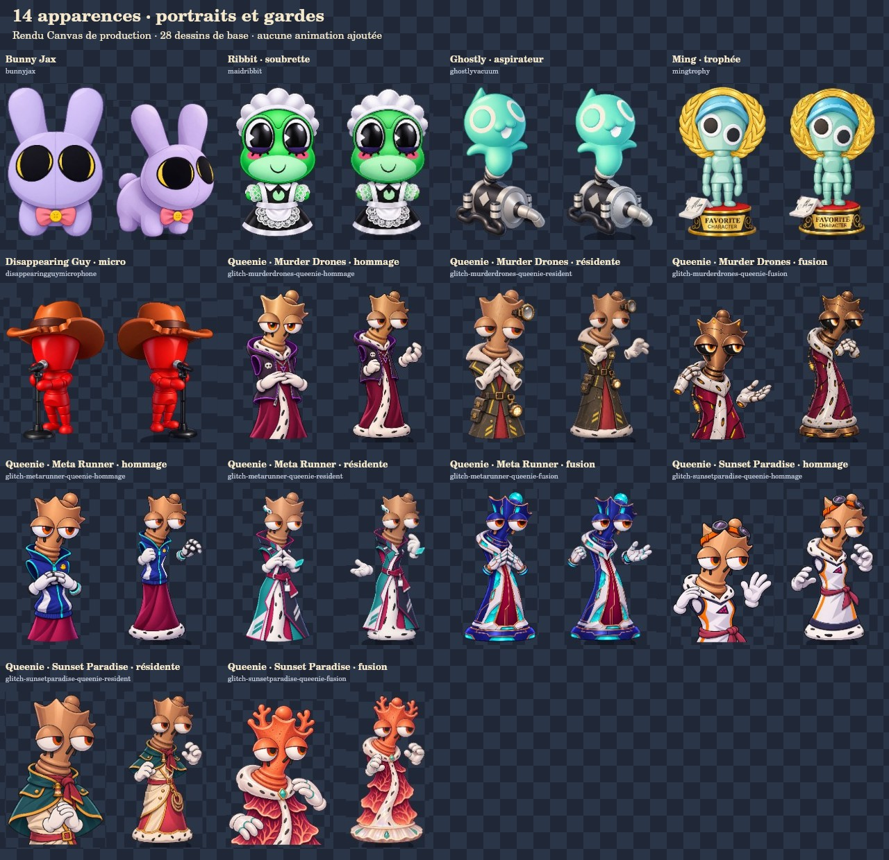

# Sprites de base — continuation du 25 novembre 2026

Ce dossier conserve la production et les contrôles du **lot A** de la reprise
précédente. Ses 32 PNG ont ensuite été récupérés pour la
[livraison consolidée A + B](../base-sprites-20261125-b/README.md).
Le classeur était encore au socle de 508 costumes : sa mise à jour effective
est documentée dans la [revue commune A + B](../base-sprites-20261125-b/workbook/README.md).

Cette continuation ajoute **32 PNG natifs** au moteur commun de CainOS et de
The Amazing Digital Circus: Encore : **14 apparences avec portrait et garde**
(28 images), puis **quatre projectiles individuels**. Aucune animation ni pose
d'action supplémentaire n'est créée. Les fichiers installés sont identiques,
octet par octet, aux sorties natives de l'outil de génération.

## Contenu livré

| Groupe | Apparences ou motifs | PNG |
| --- | --- | ---: |
| Adaptations de références officielles | Bunny Jax ; Ribbit — Maid Pendantz ; Ghostly — aspirateur ; Ming — trophée ; Disappearing Guy — microphone | 10 |
| Queenie × Murder Drones | Hommage à Uzi ; Archiviste de Copper-9 ; Reine automate | 6 |
| Queenie × Meta Runner | Hommage à Tari ; Stratège de Silica City ; Avatar royal | 6 |
| Queenie × Sunset Paradise | Hommage à Meggy ; Gardienne du phare ; Reine du récif | 6 |
| Projectiles originaux Encore | Dard royal de Queenie ; bulle-nénuphar de Ribbit ; balle de Kaufmo ; étoile de Ming | 4 |
| **Total** | **14 apparences et quatre projectiles** | **32** |

Les neuf tenues Queenie sont des créations originales du jeu, inspirées des
univers crédités. Elles ne sont pas présentées comme des apparitions canoniques.
Les projectiles sont également des adaptations originales pour les techniques
existantes, sans revendication de pouvoir officiel.

Le précédent échange annonçait 28 images de personnages supplémentaires, mais
elles n'étaient présentes ni dans la tête publiée `616a585274506f20c54386d8be07a76e75e1f198`
ni dans les branches examinées. Cette passe les **recrée** et les raccorde au
catalogue ; elle ne compte pas des fichiers prétendument récupérés.

## Intégration et conservation

Les 14 apparences sont ajoutées après les 508 costumes publiés. Leurs
identifiants, leurs propriétaires et leurs sources sont définis dans
[`combat/base-sprite-continuation-20261125.mjs`](../../../combat/base-sprite-continuation-20261125.mjs).
Les 64 combattants, les 508 costumes précédents et les 405 crossovers précédents
restent identiques à leur sérialisation du
[point de départ](integration-baseline.json), dans le même ordre.

Le catalogue atteint **522 costumes**, dont **414 crossovers**, et **38
apparences au contrat de dessin statique**. Les 64 combattants, 640 techniques
et 27 arènes partagées conservent leurs règles et leur nombre. Les neuf arènes
des univers crossover avaient déjà leurs bases ; aucune arène en double n'est
ajoutée.

Chaque nouvelle apparence emploie `selection.png` dans le portrait et
`stance.png` pendant les états de jeu. Le déplacement et le miroir suivent la
simulation existante. Aucun cycle dessiné, découpage de membres ou nouvelle
animation de pose n'est introduit. La garde de Disappearing Guy conserve son
orientation native gauche (`nativeFacing: -1`). Le socle illustré de Ming et
son texte suivent le même miroir que le reste du sprite.

Les quatre nouveaux projectiles ont un mouvement graphique `fixed`. Ils
remplacent les motifs partagés de leurs propriétaires dans les techniques
existantes, y compris après un renvoi. Les 15 images historiques de projectiles
sont conservées sans changement ; le catalogue compte désormais 19 motifs.

## Références et décisions de dessin

- [Dix images adaptées de références officielles](official/README.md) : sources,
  traits visibles et limites propres à chaque sujet.
- [Queenie dans Murder Drones et Meta Runner](queenie-two-worlds/brief.md) : la
  figurine officielle de reine d'échecs guide l'anatomie ; les univers guident
  les nouveaux costumes.
- [Queenie dans Sunset Paradise](root-sunset/prompts.json) : trois directions
  originales, avec retrait du socle commercial indépendant d'une première garde.
- [Projectiles](projectile-prompts.json) : un motif isolé par PNG et aucun
  ensemble de trames.

Maid Pendantz conserve le bas de costume masqué par la jupe dans sa référence
commerciale. Aucune jambe ni chaussure inconnue n'est inventée. Cette composition
statique visible est différente de Café Ribbit. Les éléments commerciaux
indépendants (attache de porte-clé, portail de présentation, socle noir séparé)
ne sont pas assimilés au corps du personnage. Le trophée et le socle illustré
propres à Ming font, eux, partie du motif retenu.

## Preuves

| Contrôle de cette passe | Résultat |
| --- | ---: |
| Gate complet `npm run qa` | Réussi, avec les deux builds normaux |
| Tests Node relancés sur le manifeste final | 467 / 467, zéro échec et zéro ignoré |
| Build CainOS, comparaison SHA-256 | 6 233 fichiers identiques, zéro différence |
| Build autonome, comparaison SHA-256 | 6 229 fichiers identiques, zéro différence |
| Illustrations dans chaque build | 6 162 |
| Fichiers du jeu dans chaque build | 65 |
| Canvas des 14 apparences | 280 contrôles, 840 appels de dessin |
| Canvas des 19 projectiles | 38 tirs, 36 renvois, 74 contrôles |

Le manifeste final est `0.7.0-4ad2d50212cf` ; l'art est `bc96bca6d061bb86`.
Les deux sorties de build ont été produites successivement dans un répertoire
externe commun, pour limiter l'espace de travail, puis comparées avant la
production de la sortie suivante. Les fichiers publiés n'ont pas été allégés.

- [Inventaire des 32 PNG](asset-inventory.json) : empreintes SHA-256, tailles,
  dimensions, alpha et vérification des copies natives ; **40 612 943 octets**.
- [Vérification de la passe](verification.json) : commandes, résultats, sources
  gelées, intégrité des anciens catalogues et limites navigateur.
- [Revue Canvas des personnages](canvas/README.md) : 14 planches, 280 contrôles
  état/direction et 840 appels de dessin du renderer de production.
- [Revue Canvas des projectiles](canvas-projectiles/projectile-canvas-review.json) :
  19 motifs, 38 tirs simulés, 36 renvois effectifs et 74 contrôles de dessin.
- [Build CainOS](build-cainos.json) et [build autonome](build-standalone.json) :
  comparaison de chaque fichier publié à sa source.
- [Revue effective du classeur A + B](../base-sprites-20261125-b/workbook/README.md) :
  conservation des cellules et notes, ajouts de production, correction des dix
  scènes finales et vues relues lors de la livraison consolidée.
- [Travaux encore ouverts](remaining-work.md).

## Corrections des contrôles antérieurs

Deux échecs de la campagne navigateur du commit précédent ont été traités :
les dix routes d'abstraction ont un sixième tableau réellement distinct dans
la salle de calibration, et la recherche de Pomni reconnaît aussi son
abstraction originale déjà publiée. L'exigence de six tableaux distincts et
le contrôle de mise à jour immédiate de la recherche sont conservés.

Une assertion historique sur Café Ribbit interdisait globalement tout futur
`maidribbit`. Elle vérifie maintenant les collections Café figées, préservant
leur séparation avec la nouvelle paire Pendantz. Les empreintes et reçus des
anciens lots ne sont pas changés.

Les résultats historiques restent datés dans leurs propres dossiers. Le rendu
Canvas et la comparaison des PNG ne certifient ni une équivalence canonique
1:1 ni les interactions navigateur. Ces dernières restent soumises à la
campagne GitHub Actions du commit publié.
