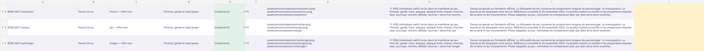
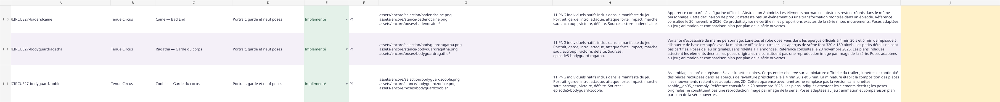
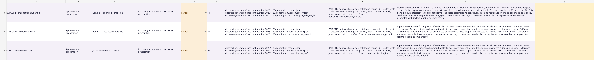
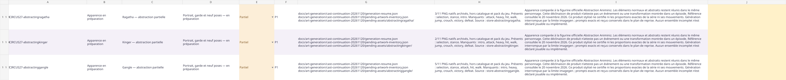
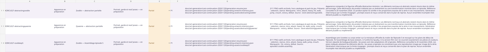

# Préparation du classeur — export bloqué

Ces vues montrent les quinze lignes Production préparées en mémoire : six apparences complètes et neuf ensembles partiels. Elles ne proviennent pas d’un nouveau XLSX livré. Le classeur et le JSON de suivi du 19 novembre restent inchangés.

La préparation cible 3 115 lignes Production, 2 265 lignes QA et 135 références. Les fichiers installés conservent 3 100 lignes Production, 2 260 lignes QA et 120 références. Les six ensembles complets sont bien intégrés au jeu ; les 36 dessins des neuf autres apparences sont archivés hors runtime.

[État exact de la tentative](../workbook-review.json) · [Checkpoint préparé compressé](../workbook-preparation-checkpoint.json.gz)

Le checkpoint conserve les données, les états de référence et les plages nécessaires à une reprise. Son objet `verificationDraft` contient des champs prévus pour une vérification finale. Ils ne constituent pas une preuve d’export ou de réimport réussis : `workbookSHA256` est nul et `exportRoundTripPassed` vaut faux. Les journaux des trois derniers essais mesurés sont dans [diagnostics](diagnostics/).

## Lignes Production préparées

