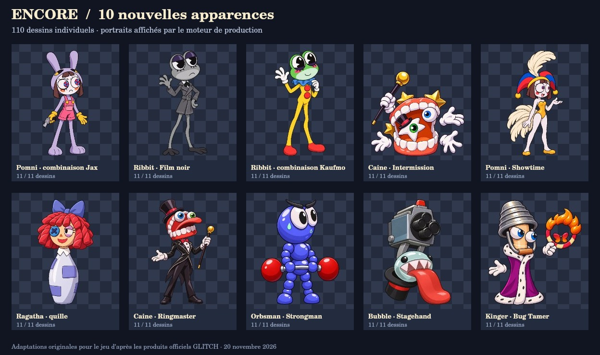

# Dix apparences d’Encore — production et galerie du 20 novembre 2026

**110 PNG natifs distincts complètent dix apparences, avec onze fichiers par famille.** Les dessins sont intégrés au catalogue commun de CainOS et du standalone. Le lot comprend **90 originaux récupérés à l’octet près et 20 remplacements régénérés** après une perte d’environnement, pour **130 610 966 octets**.

[Bilan détaillé de la passe](../../COMBAT_CAST_DISCOVERIES_2026-11-20.md) · [Manifeste de complétion](generation-completion.json) · [Inventaire des assets](asset-inventory.json) · [Vérification consolidée](verification.json) · [Candidats encore ouverts](remaining-candidates.md)

## Galerie des dix familles

Chaque famille possède un portrait de sélection, une garde et neuf actions : entrée, attaque, coup lourd, impact reçu, marche, saut, accroupissement, victoire et défaite. Les galeries rassemblent des images individuelles pour leur revue ; le jeu utilise un fichier séparé pour chaque emplacement.

| Apparence | Dessins | Galerie | Définition et source |
| --- | ---: | --- | --- |
| Pomni — combinaison Jax | 11/11 | [Actions et portrait](review/jaxsuitpomni/README.md) | [Définition](definitions/jaxsuitpomni.json), [peluche officielle][jax-plush] |
| Ribbit — film noir | 11/11 | [Actions et portrait](review/noirribbit/README.md) | [Définition](definitions/noirribbit.json), [Pendantz][ribbit] |
| Ribbit — costume Kaufmo | 11/11 | [Actions et portrait](review/kaufmosuitribbit/README.md) | [Définition](definitions/kaufmosuitribbit.json), [Pendantz][ribbit] |
| Caine — Intermission | 11/11 | [Actions et portrait](review/intermissioncaine/README.md) | [Définition](definitions/intermissioncaine.json), [Costume Adventure][adventure] |
| Pomni — Showtime | 11/11 | [Actions et portrait](review/showtimepomni/README.md) | [Définition](definitions/showtimepomni.json), [Side Show][sideshow] |
| Ragatha — Quille de bowling | 11/11 | [Actions et portrait](review/bowlingpinragatha/README.md) | [Définition](definitions/bowlingpinragatha.json), [Side Show][sideshow] |
| Caine — Maître de piste noir | 11/11 | [Actions et portrait](review/ringmastercaine/README.md) | [Définition](definitions/ringmastercaine.json), [Side Show][sideshow] |
| Orbsman — homme fort | 11/11 | [Actions et portrait](review/strongmanorbsman/README.md) | [Définition](definitions/strongmanorbsman.json), [Side Show][sideshow] |
| Bubble — régisseur | 11/11 | [Actions et portrait](review/stagehandbubble/README.md) | [Définition](definitions/stagehandbubble.json), [Side Show][sideshow] |
| Kinger — dompteur d’insectes | 11/11 | [Actions et portrait](review/bugtamerkinger/README.md) | [Définition](definitions/bugtamerkinger.json), [Side Show][sideshow] |

Les dix apparences conservent les kits de leurs personnages. Les objets portés restent des accessoires visuels. Le corps de quille de Ragatha, les quatre gants flottants d’Intermission Caine, la caméra de Bubble et les deux mains détachées de Kinger sont décrits dans les définitions. La sélection de Ragatha quille est nativement orientée à gauche ; tous les autres emplacements du lot sont à droite, selon le [relevé par fichier](native-facing.json).

## Reprise et provenance

**Neuf poses ont été créées pendant cette dernière reprise** : `jump`, `crouch` et `victory` de Showtime Pomni ; `intro`, `attack`, `heavy`, `hit`, `walk` et `victory` de Bug Tamer Kinger. Le total de vingt régénérations inclut onze remplacements produits lors de reprises précédentes.

Les huit autres familles représentent 88 originaux récupérés. Showtime Pomni et Bug Tamer Kinger conservent chacun leur défaite originale et dix images régénérées. Les fichiers de [generated](generated) et leurs reçus gardent les prompts, références, empreintes et identifiants de génération. Le manifeste distingue les fichiers retrouvés des nouveaux remplacements. Les PNG actifs conservent les octets et l’alpha natifs de leurs sources acceptées.

**Une référence historique demeure perdue** : la sélection originale utilisée pour la défaite de Bug Tamer Kinger. La défaite a bien été récupérée. Son [reçu](generated/bugtamerkinger/defeat.json) conserve l’empreinte de cette ancienne référence et interdit de l’assimiler à la sélection régénérée qui occupe aujourd’hui le même chemin logique.

## Preuves de vérification

| Contrôle exécuté | Résultat | Preuve |
| --- | --- | --- |
| Audits, tests Node et builds | 405/405 tests, zéro échec ; CainOS et standalone construits | [Résultat QA](qa-result.json), [journal](qa.log) |
| Rendu Canvas de production sous Node/Skia | 90 actions, 10 gardes, 10 portraits ; 200 vérifications, aucun manque | [Synthèse](canvas-summary.json), galeries ci-dessus |
| Revue visuelle des exports | Dix planches d’actions et dix portraits examinés ; aucun défaut bloquant à leur échelle de revue | [Revue visuelle](visual-review.json) |
| Audit indépendant final | 110 PNG et orientations conformes ; 215/216 références exactes, une ancienne référence perdue documentée | [Audit final](final-runtime-audit.json) |
| Copies dans les deux distributions | 220 comparaisons d’assets natifs et 18 de modules conformes | [Intégrité](build-integrity.json) |
| Conservation | 5 546 fichiers Encore antérieurs et six fichiers de suivi ou checkpoints inchangés | [Intégrité](build-integrity.json), [suivi conservé](preserved-tracker-and-checkpoints.json) |
| Navigateur local, deux suites | Blocage socket avant navigation ; zéro contrôle exécuté | [Dessins d’action](browser-result.json), [réunion du casting](merge-browser-result.json) |

L’[audit indépendant préalable](independent-audit.json) couvre les huit familles alors complètes, soit 88 PNG, et les dix sources nommées. Ses 165 contrôles de références portables ont réussi. L’audit final couvre ensuite les 110 fichiers, les 23 anciennes définitions d’apparences et le préfixe inchangé des 452 costumes antérieurs. La revue visuelle examine les planches à leur échelle d’export ; elle ne remplace pas l’inspection individuelle de tous les PNG à leur résolution native.

La [CI du précédent commit](https://github.com/darknigthmare/CainOS/actions/runs/44708369491) avait échoué sur l’attente obsolète de la garde-robe de Queenie. La suite navigateur a été corrigée pour attendre son apparence existante `abstractingqueenie`. Son exécution locale reste bloquée avant navigation. Le point de contrôle de ce dossier n’atteste pas encore la CI distante de la nouvelle révision ; la [vérification consolidée](verification.json) conserve cette distinction.

Le [runtime après intégration](runtime-counts.json) compte **54 combattants, 462 costumes, 33 apparences Circus supplémentaires, 1 597 images de personnages hors crossover, 5 700 images hors ligne et 700 fiches de fidélité**. Les 22 arènes partagées restent présentes ; leur existence ne clôt pas la revue de tous les lieux ou de tous les alignements au sol.

## Portée et travail restant

Les sources sont des produits officiels GLITCH ; les dessins sont des adaptations statiques pour le fan-game. Une référence de produit n’atteste pas sa présence dans un épisode, et un ensemble de onze poses ne constitue pas un cycle d’animation complet. Les interprétations de proportions et d’expression sont consignées dans les définitions et l’audit.

Le classeur Excel installé reste inchangé, sans nouvel essai d’export dans cette passe. La reprise atomique du suivi, les candidats répertoriés dans [remaining-candidates.md](remaining-candidates.md), les cycles d’animation, les crossovers des quarante PNJ promus et la comparaison canonique scène par scène restent ouverts. Les 63 poses terminées dans la passe historique précédente ne sont pas remises dans la file des manques.

[jax-plush]: https://glitchproductions.store/products/jax-suit-pomni-plush
[ribbit]: https://glitchproductions.store/products/ribbit-pendantz-blindbox
[adventure]: https://glitchproductions.store/products/digital-circus-animiniz-costume-adventure-series
[sideshow]: https://glitchproductions.store/products/digital-circus-animiniz-side-show-series
