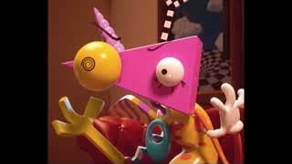
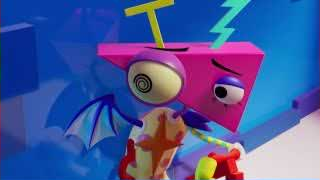
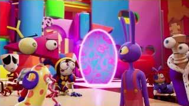
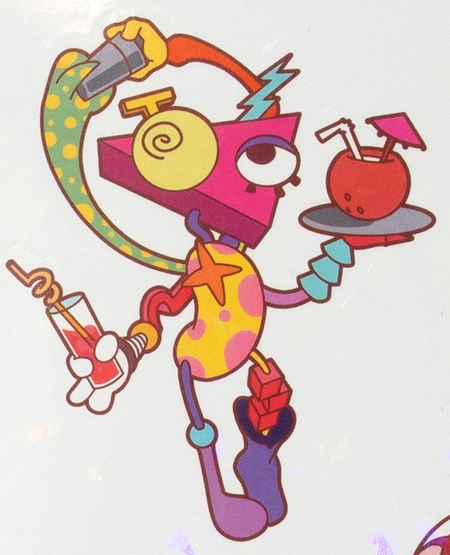

# Références complémentaires du casting — 20 novembre 2026

Cette recherche complète le [relevé précédent](../cast-continuation-20261120/remaining-candidates.md) avec de nouvelles observations primaires. Elle précise les mains de Zooble de l’épisode 3 et le bras multicolore de l’épisode 6. Elle documente également une illustration officielle supplémentaire de Zooble dans les aperçus publics de l’artbook.

**Aucun des huit candidats prioritaires ne dispose encore d’une référence suffisamment complète pour lancer une famille de poses.** La nouvelle illustration de marchandise montre une silhouette entière, mais certains raccords des bras sont cachés. Aucun job supplémentaire n’est donc déclaré prêt. Les **102 dessins et 63 prompts manquants** du checkpoint précédent ne sont pas modifiés par cette recherche ; aucun appel de génération n’a été effectué.

## Documents et méthode

- [Matrice des neuf candidats](candidate-matrix.json) : huit recherches prioritaires et une nouvelle illustration officielle, avec limites et prochaine preuve utile.
- [Sources primaires et empreintes](primary-sources.json) : titres, chaîne, liens, pages de storyboard, cellules, rectangles de découpe et SHA-256 des neuf extraits conservés.
- [Checkpoint de production inchangé](../cast-continuation-20261120/generation-resume.json) : les neuf apparences déjà en production et leurs 63 poses manquantes restent la priorité de génération.

Les titres, identifiants vidéo et identifiant de la chaîne GLITCH (`UCn_FAXem2-e3HQvmK-mOH4g`) ont été vérifiés dans les métadonnées publiques des cinq trailers utilisés. Leurs storyboards offrent des échantillons espacés d’une seconde, en cellules natives de **320 × 180 pixels**. Ces échantillons peuvent retrouver un angle absent des vues d’épisode espacées de dix secondes, mais n’augmentent pas la définition spatiale des personnages.

Les neuf fichiers sous `references/` sont des extraits ciblés de sources publiques. Ils conservent les pixels disponibles : aucune reconstruction, retouche, suppression de fond ni augmentation de définition n’a été appliquée. Ils servent à documenter l’observation et ne sont pas des assets du jeu. Les pages complètes de storyboard et les planches promotionnelles complètes ne sont pas ajoutées au dépôt.

La revue n’est pas un visionnage continu des épisodes ou un inventaire exhaustif du catalogue GLITCH. Les pages de storyboard effectivement examinées sont indiquées dans le manifeste ; les captures finales non examinées ne sont pas présentées comme vérifiées.

## Ce que les nouvelles vues établissent

### Zooble — épisode 3 : deux mains mieux documentées

Le [trailer officiel, vers 36 secondes](https://www.youtube.com/watch?v=x287j7Vby0U&t=36s), montre une main jaune anguleuse à gauche de l’image et un gant blanc à droite. Le cône rose et l’antenne rayée restent visibles au-dessus. Cela précise la mention antérieure d’une seule main blanche ; le plan ne révèle pas l’ensemble des raccords ni le bas du corps.

**Suite :** une vue debout montrant chaque chaîne de pièces, jusqu’aux deux pieds. Le plan assis du trailer ne suffit pas à établir les connexions cachées par la pose.

### Zooble — épisode 6 : meilleure lecture du bras à main jaune

Les échantillons du [trailer officiel à 32 secondes](https://www.youtube.com/watch?v=viNz5TiNgSc&t=32s), [41 secondes](https://www.youtube.com/watch?v=viNz5TiNgSc&t=41s) et [46 secondes](https://www.youtube.com/watch?v=viNz5TiNgSc&t=46s) apportent des angles complémentaires. Ils montrent une pièce violette du côté de l’épaule, un segment clair à dominante jaune/verte, une petite jonction claire et un tube rouge coudé, avec une main jaune visible dans les vues complémentaires. Le segment noir/blanc et la main blanche de l’autre bras restent distincts.

La forme précise des petites jonctions et le raccord complet de la jambe rouge au pied violet restent trop peu définis à cette résolution. Les armes visibles sont des accessoires de scène ; elles ne remplacent pas une partie de l’anatomie. **Cet assemblage reste le meilleur prochain candidat de recherche, sans être promu à la génération.**

### Zooble — épisode 8 : confirmation du haut du corps

Le [trailer officiel à 39 secondes](https://www.youtube.com/watch?v=4lFnIlH06Sw&t=39s) puis [40 secondes](https://www.youtube.com/watch?v=4lFnIlH06Sw&t=40s) confirme le Y jaune, le ressort rayé, l’anneau violet et l’asymétrie des bras. La première vue, sombre, comprend une main jaune. Le second plan laisse les petites connexions et le bas du corps hors d’une lecture complète.

Ces vues ne justifient pas une nouvelle description exacte des pieds ou des doigts.

## Nouvelle illustration officielle : Zooble et les cocktails

La [page officielle de l’artbook](https://glitchproductions.store/products/digital-circus-artbook) publie un aperçu de sa planche de stickers. Son illustration de Zooble montre le personnage en entier : tête rose, T jaune, éclair cyan, étoile orange, corps jaune tacheté, membres supplémentaires manipulant un shaker, un verre et un plateau, jambe violette avec joint cyan et jambe rouge anguleuse terminée par un pied violet. La [source promotionnelle précise](https://glitchproductions.store/cdn/shop/files/Tier2_3_Stickers_1.webp?v=1789097565&width=1600) est attribuée dans le manifeste.

`zooble__artbook_cocktail` est un **libellé de recherche descriptif**, pas un nom officiel de costume. La silhouette complète constitue une nouvelle preuve, mais plusieurs attaches supérieures passent derrière la tête. Le relevé ne fixe pas un nombre de bras ou une chaîne de raccords que l’image ne permet pas encore de lire sans ambiguïté. Une autre vue officielle est nécessaire avant d’en tirer des poses indépendantes.

Cette illustration est classée **marchandise officielle**, sans affirmation de présence en épisode. La ressemblance des antennes, de l’étoile et des jambes avec certaines vues de l’épisode 6 n’établit pas l’identité complète des assemblages : les bras supplémentaires et le traitement de l’aile diffèrent. Les jambes unies du sticker et ses reflets holographiques ne doivent pas remplacer les détails du modèle de l’épisode. Les reflets du support ne constituent pas des motifs de peau.

Les trois autres aperçus publics examinés — concepts, composition de pages et seconde planche de stickers — n’apportent pas de vue complémentaire suffisante des candidats prioritaires. Aucun livre complet ni page réservée à l’achat n’a été consulté.

## Matrice de décision

| Candidat | Apport de cette recherche | Preuve encore nécessaire |
| --- | --- | --- |
| Zooble, épisode 2 | Aucun nouveau modèle primaire complet obtenu. Le [relevé précédent](../cast-continuation-20261120/presidential-zooble-primary-review.json) reste la référence. | Mains et petites connexions des membres lisibles. |
| Zooble, épisode 3 | Deux mains mieux définies dans le [trailer à 36 s](https://www.youtube.com/watch?v=x287j7Vby0U&t=36s). | Chaînes complètes des bras et des jambes dans une vue exploitable. |
| Zooble civil, épisode 4 | La vue du [trailer à 29 s](https://www.youtube.com/watch?v=abZtsmMUbJo&t=29s) montre l’uniforme Spudsy, conservé comme comparaison explicite. | Corps civil entier ; ne pas enlever mentalement l’uniforme et inventer dessous. |
| Zooble, épisode 6 | Angles complémentaires du bras à main jaune, [32–46 s](https://www.youtube.com/watch?v=viNz5TiNgSc&t=32s). | Petites jonctions et raccord de la jambe rouge au pied violet. |
| Zooble civil, épisode 7 | Les échantillons du [trailer officiel](https://www.youtube.com/watch?v=VI6XO8EijT4) ne montrent pas l’assemblage civil en entier avec assez de détail. | Bras, pieds et raccords de l’apparence avant la plage. |
| Zooble, épisode 8 | Haut du corps corroboré dans le [trailer à 39–40 s](https://www.youtube.com/watch?v=4lFnIlH06Sw&t=39s). | Vue entière bien éclairée, mains et petites pièces comprises. |
| Jax australien, épisode 5 | La liste explicite du [Jax Pendantz](https://glitchproductions.store/products/jax-pendantz) ne nomme pas cette tenue. Une variante secrète ne sert pas de preuve. | Bas du pantalon, pieds et chaussures ; aucun remplacement par Hunter Jax. |
| Gangle Film noir | Aucun nouvel angle primaire obtenu pour le bas du corps ; conservation du [relevé de l’épisode 5](../cast-continuation-20261120/presidential-zooble-primary-review.json). | Corps sous le bar ; ne pas choisir un vêtement inférieur par supposition. |
| Zooble, illustration cocktail de l’artbook | Nouvelle silhouette entière officielle, distincte dans le registre de recherche. | Nombre et attaches des membres, angle complémentaire avant une série de poses. |

## Incidence sur la production et vérification

Le résultat est documentaire : **neuf extraits ciblés, neuf lignes de recherche, zéro nouvelle apparence prête, zéro job ajouté**. Aucun fichier de jobs prêts n’est créé. Le runtime, le workbook, les scripts et les rapports historiques restent hors du périmètre de cet audit.

Le manifeste relie chaque extrait à son image source, son rectangle de découpe et son SHA-256. Les JSON ont été relus, les neuf fichiers décodés et leurs dimensions et empreintes vérifiées. Les références croisées de la matrice sont résolues. Ces contrôles établissent la traçabilité des documents ; ils ne constituent pas une validation de fidélité canonique ni un essai en jeu.

La suite concrète reste de terminer les **63 poses déjà définies** lorsque la génération redevient disponible, puis d’utiliser cette matrice pour rechercher les quelques vues nécessaires aux nouveaux assemblages. Aucune partie cachée n’est comblée pour augmenter artificiellement le nombre d’apparences prêtes.
