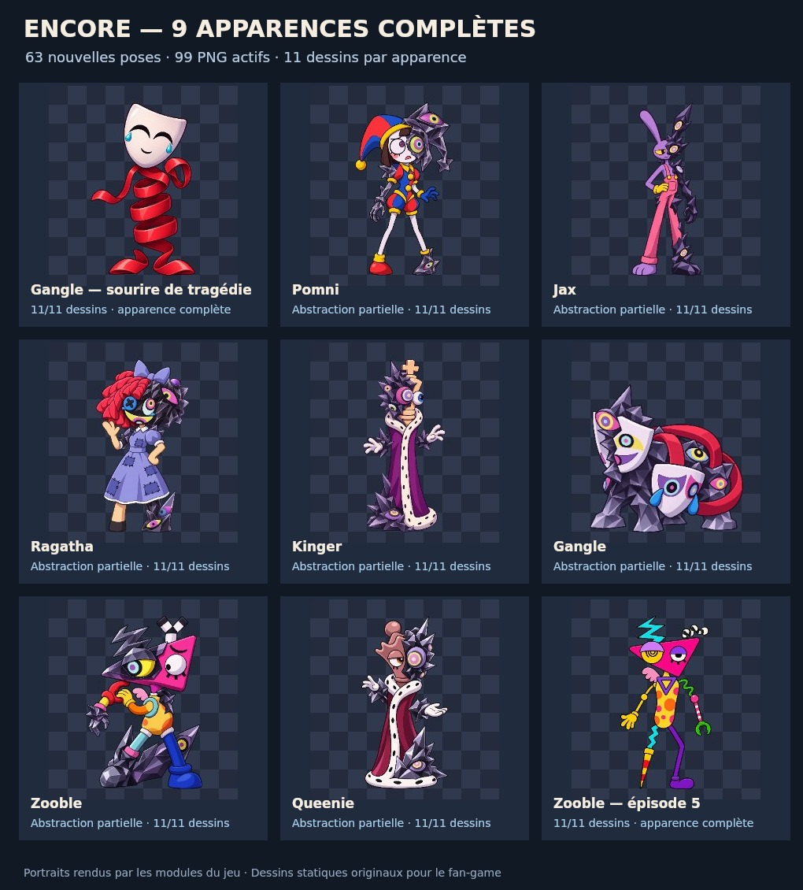

# Encore — neuf apparences complètes

Les **63 nouvelles poses** complètent les **36 dessins préservés**, soit **99 PNG actifs** et onze emplacements pour chacune des neuf apparences.

[Bilan de la passe](../../COMBAT_CAST_RESUMPTION_2026-11-20.md) · [Inventaire et provenance](generation-completion.json) · [Vérifications](verification.json)

## Planches du moteur Canvas

Ces neuf planches montrent les actions statiques à travers les modules de présentation du jeu. Les ombres, arcs de coups et anneaux de victoire viennent du renderer. Les PNG natifs restent séparés et inchangés.

| Apparence | Poses nouvellement générées | Jeu complet | Planche |
| --- | ---: | ---: | --- |
| Gangle — sourire de tragédie | 9 | 11/11 | [Neuf actions](canvas/smilingtragedygangle/actions-smilingtragedygangle.jpg) |
| Pomni — abstraction partielle | 9 | 11/11 | [Neuf actions](canvas/abstractingpomni/actions-abstractingpomni.jpg) |
| Jax — abstraction partielle | 8 | 11/11 | [Neuf actions](canvas/abstractingjax/actions-abstractingjax.jpg) |
| Ragatha — abstraction partielle | 8 | 11/11 | [Neuf actions](canvas/abstractingragatha/actions-abstractingragatha.jpg) |
| Kinger — abstraction partielle | 9 | 11/11 | [Neuf actions](canvas/abstractingkinger/actions-abstractingkinger.jpg) |
| Gangle — abstraction partielle | 6 | 11/11 | [Neuf actions](canvas/abstractinggangle/actions-abstractinggangle.jpg) |
| Zooble — abstraction partielle | 9 | 11/11 | [Neuf actions](canvas/abstractingzooble/actions-abstractingzooble.jpg) |
| Queenie — abstraction partielle | 2 | 11/11 | [Neuf actions](canvas/abstractingqueenie/actions-abstractingqueenie.jpg) |
| Zooble — Assemblage épisode 5 | 3 | 11/11 | [Neuf actions](canvas/zoobleep5/actions-zoobleep5.jpg) |

## Preuves

- [63 PNG natifs, 102 préexistants, 99 copies actives et huit essais rejetés](native-integrity-audit.json).
- [99 directions du runtime comparées aux images relues](runtime-direction-review.json).
- [404 tests et deux builds](qa.log) ; [198 comparaisons des PNG dans les distributions](build-integrity.json).
- [Neuf rendus isolés, 81 actions, neuf gardes, neuf portraits et 180 contrôles gauche/droite](canvas-runs.json).
- [Revue visuelle et limites de continuité des poses statiques](visual-review.json).
- [Tentative navigateur bloquée avant navigation par les permissions locales de Chromium](browser-attempt.json).

Le [checkpoint initial](../cast-continuation-20261120/generation-resume.json) reste intact. Le manifeste de complétion le relie aux 63 nouvelles sorties, sans faire disparaître les essais rejetés ni modifier les anciens fichiers. Les sources officielles et les adaptations du fan-game restent distinguées.

Le classeur installé attend toujours une reprise de son export atomique ; il ne représente pas encore cette passe.
