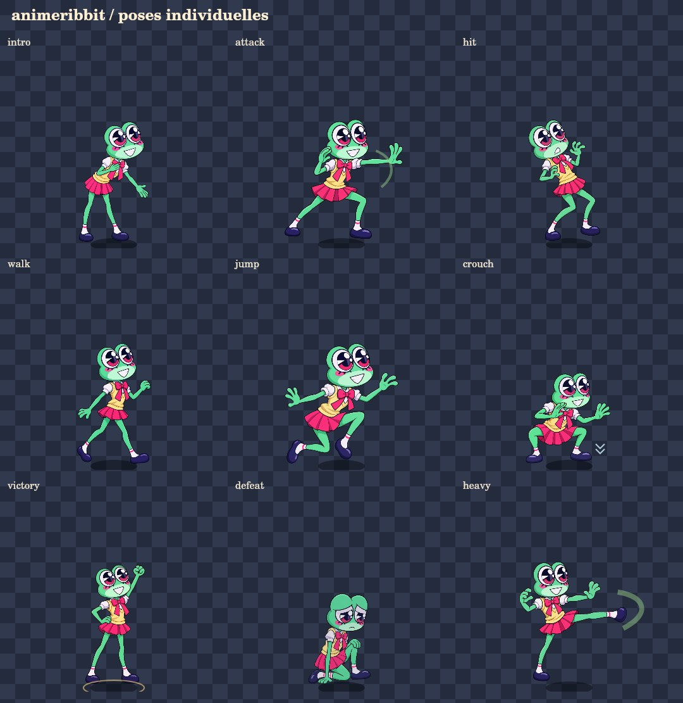
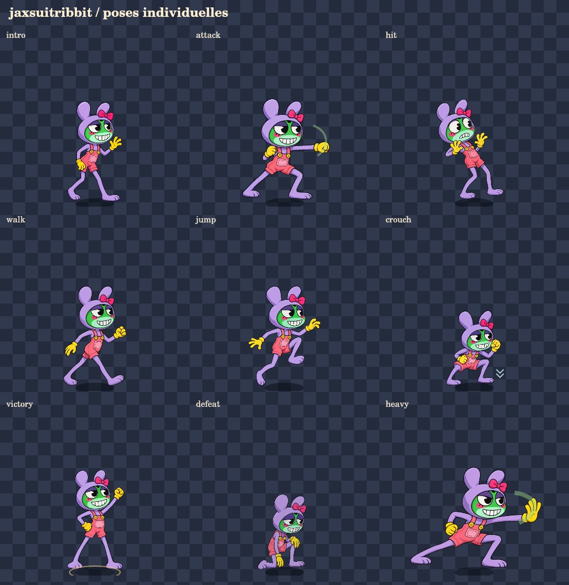

# Ribbit — Anime et combinaison Jax

Lot du 20 novembre 2026 : **2 apparences complètes, 22 PNG natifs distincts**.
Chaque famille comprend sélection, garde et neuf actions séparées.

[Rapport de continuation](../../COMBAT_RIBBIT_CONTINUATION_2026-11-20.md) ·
[Manifeste final](generation-completion.json) · [Vérification](verification.json) ·
[Candidats restants](remaining-work.md)

## Galeries rendues par le moteur du jeu

### Anime Ribbit

[Revue individuelle](review/animeribbit/README.md) ·
[Portrait](review/animeribbit/archive-portraits-01.jpg) ·
[Définition](definitions/animeribbit.json) · [Originaux et reçus](generated/animeribbit)

### Jax-Suit Ribbit

[Revue individuelle](review/jaxsuitribbit/README.md) ·
[Portrait](review/jaxsuitribbit/archive-portraits-01.jpg) ·
[Définition](definitions/jaxsuitribbit.json) · [Originaux et reçus](generated/jaxsuitribbit)

## Traçabilité

- [Inventaire des 22 fichiers actifs](asset-inventory.json) et [orientations natives](native-facing.json).
- [Références officielles inspectées](../ribbit-candidates-20261120/reference-review.md) et [URLs et empreintes](../ribbit-candidates-20261120/references/downloads.json).
- [405 tests et deux builds](qa-result.json), [40 contrôles Canvas](canvas-summary.json) et [copies des distributions](build-integrity.json).
- [Revue visuelle finale](visual-review.json) et [revue indépendante](ribbit-independent-review.json).
- [Tentative Chromium bloquée avant navigation](browser-result.json), sans assertion de réussite navigateur.
- [Catalogue effectif](runtime-counts.json) : 54 combattants, 464 costumes, 22 arènes et 5 722 images hors ligne.

Les originaux actifs sont copiés à l’octet près depuis les générations acceptées.
Les planches de cette page sont des vues de contrôle ; les fichiers du jeu restent
individuels. Les costumes sont fondés sur des produits dérivés officiels et leurs
poses sont adaptées au fan-game. Les cycles d’animation et la comparaison canonique
scène par scène restent ouverts.
