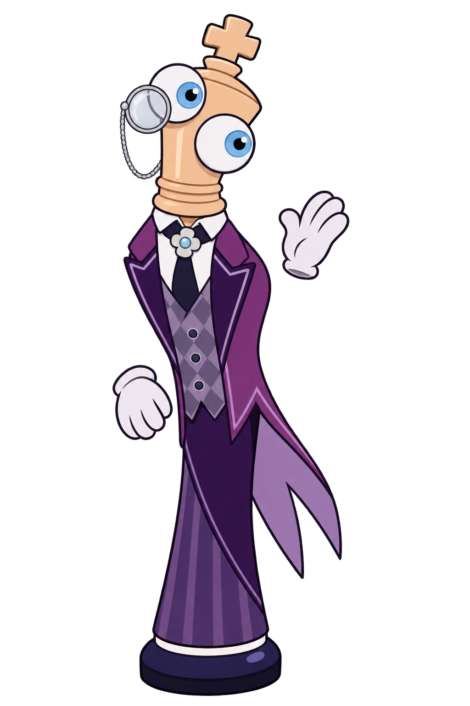
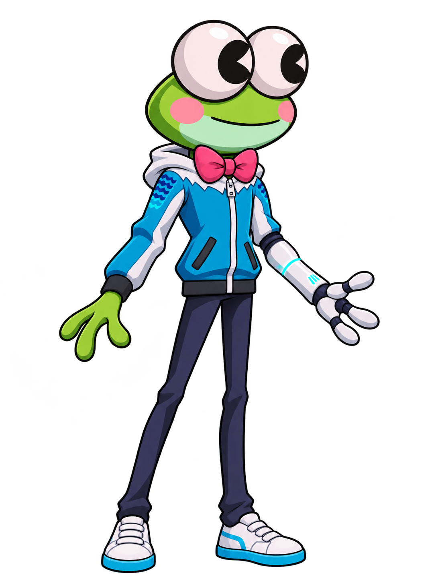
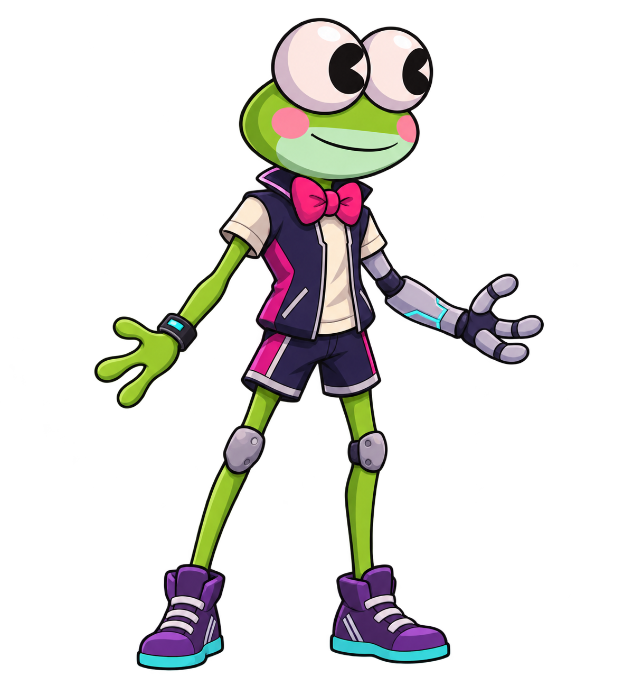
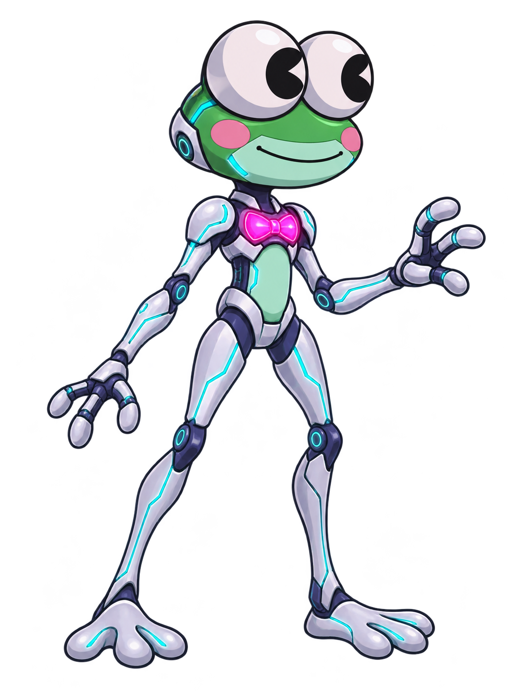
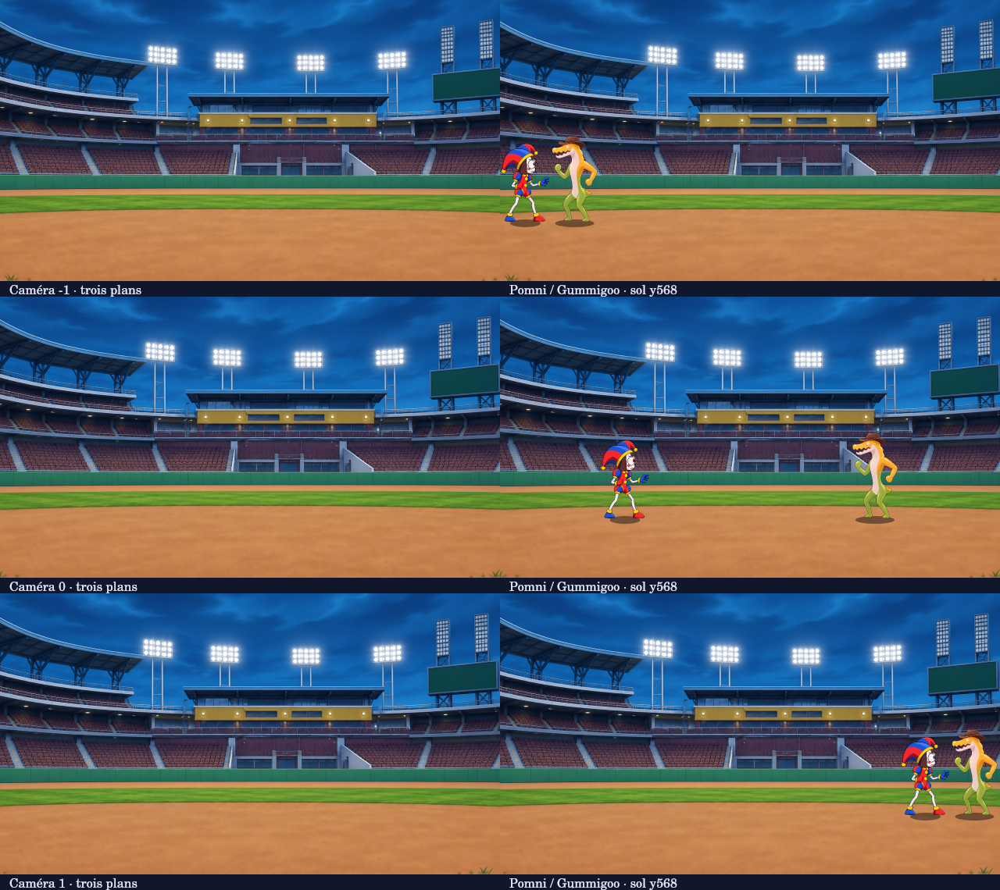

# Continuation Encore — deux Café, Meta Runner et softball

**58 PNG natifs / 55 122 465 octets**, intégrés le 20 novembre 2026. Les cinq familles comprennent chacune une sélection, une garde et neuf actions distinctes. Le stade ajoute trois plans. Les fichiers de jeu restent séparés et inchangés par rapport aux sorties natives.

[Rapport complet](../../COMBAT_CONTINUATION_B_2026-11-20.md) · [Registre des manquants](remaining-work.md) · [Classeur et réconciliation](workbook/README.md) · [Preuve consolidée](verification.json).

## Familles et galeries

| Famille | Production | Galerie du renderer | Dossier de références |
| --- | --- | --- | --- |
| Café Kinger | 11 PNG / 12 996 642 octets | [Neuf actions et portrait](review/cafekinger/README.md) | [Café](cafe/README.md) |
| Café Pomni | 11 PNG / 10 981 850 octets | [Neuf actions et portrait](review/cafepomni/README.md) | [Café](cafe/README.md) |
| Ribbit × Meta Runner — Hommage · Tari | 11 PNG / 8 248 636 octets | [Neuf actions et portrait](review/glitch-metarunner-ribbit-hommage/README.md) | [Meta Runner](metarunner/README.md) |
| Ribbit × Meta Runner — Analyste de replays | 11 PNG / 8 980 992 octets | [Neuf actions et portrait](review/glitch-metarunner-ribbit-resident/README.md) | [Meta Runner](metarunner/README.md) |
| Ribbit × Meta Runner — Avatar de synchronisation | 11 PNG / 10 788 515 octets | [Neuf actions et portrait](review/glitch-metarunner-ribbit-fusion/README.md) | [Meta Runner](metarunner/README.md) |

| Kinger — Café | Pomni — Café |
| --- | --- |
|  |  |

| Hommage · Tari | Analyste de replays | Avatar de synchronisation |
| --- | --- | --- |
|  |  |  |

Le [manifeste des personnages](generation-completion.json) relie les **55 PNG / 51 996 635 octets** aux reçus, jobs et définitions. Les variantes non retenues restent archivées ; la [revue des références Meta Runner](metarunner/reference-review.md) explique la correction de l’interprétation des aperçus alpha.

## Le stade de softball

Trois plans natifs, **3 125 830 octets**, ajoutent le lieu à Encore. Il existait déjà dans l’exploration CainOS. Les dimensions natives sont conservées : 1 672 × 941 pour le fond et le plan médian, 1 671 × 941 pour le premier plan.

[Sources, composition et limites](stage/README.md) · [Inventaire des trois plans](stage/asset-inventory.json) · [Vérification finale](stage/verification.json) · [Rendu de secours](stage/review/fallback.png).

## Résultats finaux

| Contrôle | Résultat | Preuve |
| --- | --- | --- |
| Tests et builds | 431/431, aucun échec ou ignoré, deux distributions construites | [QA](qa-result.json) · [Journal](qa.log) |
| Canvas personnages | 100 contrôles, 45 actions, cinq gardes, cinq portraits ; zéro alias ou manquant | [Synthèse Canvas](canvas-summary.json) |
| Revue visuelle | Dix planches de personnages examinées par deux lecteurs ; root a aussi inspecté les deux composites finaux du stade | [Root](visual-review.json) · [Indépendante](independent-visual-review.json) |
| Canvas stade | Six contrôles, trois caméras et trois scènes avec acteurs | [Stade final](stage/verification.json) |
| Copies des nouveaux PNG | 116 comparaisons dans les deux builds | [Intégrité](build-integrity.json) |
| Modules distribués | Vingt modules × deux builds = 40 comparaisons | [Intégrité](build-integrity.json) |
| Conservation des anciens actifs | 5 772 fichiers Encore inchangés | [Inventaire de base](historical-assets-baseline.json) · [Intégrité](build-integrity.json) |
| Préfixe des costumes | 472 objets JSON et IDs conservés dans le même ordre | [Fixture indépendante](workbook/costume-prefix-baseline.json) · [Compteurs](runtime-counts.json) |

Le paquet final contient **5 874 images / 3 173 741 905 octets**, manifeste **`0.7.0-17366238b519`**, art **`20311abb70caa13c`**, **57 fichiers de cœur**. Le catalogue expose **477 costumes**, **42 familles Circus / 462 PNG**, **384 crossovers / 3 847 fichiers** et **25 arènes partagées / 75 plans**. Les 54 arrangements dédiés restent des réemplois de ces décors.

## Classeur final

Le [classeur final](../../DIGITAL_CIRCUS_COMBAT_TRACKER.xlsx) contient **3 308 lignes Production, 2 454 lignes QA et 161 sources**. Sa comparaison de **82 697 cellules** ne relève aucune différence ; **42 formules, onze feuilles et dix tables** survivent au réimport et au recalcul. Les **50 vues** ont été inspectées dans deux lots complémentaires de 16 et 34. Le [dossier du classeur](workbook/README.md) conserve le plan, les deux revues et les résultats techniques.

## Conservation des étapes intermédiaires

- [Première QA globale](attempts/global-qa-01/receipt.json) : 430/431 avant correction du contrat précis des sources Café ; la réussite finale est séparée.
- [Gel de l’intégration Meta Runner](workbook/metarunner-runtime-freeze.json) : préflight, résolution des deux jobs de correction, activation native, idempotence et tests ciblés avant manifeste.
- [Préliminaire du stade](stage/preliminary/verification.json) : manifeste limité à ce point d’étape, distinct du manifeste complet final.
- [Ancien consolidé avant correction d’un chemin d’archive](attempts/consolidation-before-stage-archive-path-fix/verification.json) : la mise à jour porte sur les métadonnées d’un Markdown archivé ; aucun rendu, résultat de test ou runtime n’a changé.

## Limites conservées

Les créations Café adaptent des illustrations commerciales officielles ; les crossovers Meta Runner sont des designs originaux. Les parties masquées d’autres références restent non qualifiées. Onze poses par famille ne constituent pas des cycles animés complets. La revue Canvas sous Node/Skia ne vaut pas navigation, entrée, audio, service worker ou essai matériel.

Le [navigateur local](stage/browser-result.json) est explicitement **non exécuté pour cette continuation**. La [réussite CI du parent](stage/ci-parent-final.json) conserve sa révision propre. Les **1 074 tenues de PNJ restantes** et les autres travaux ouverts figurent dans le [registre](remaining-work.md).
