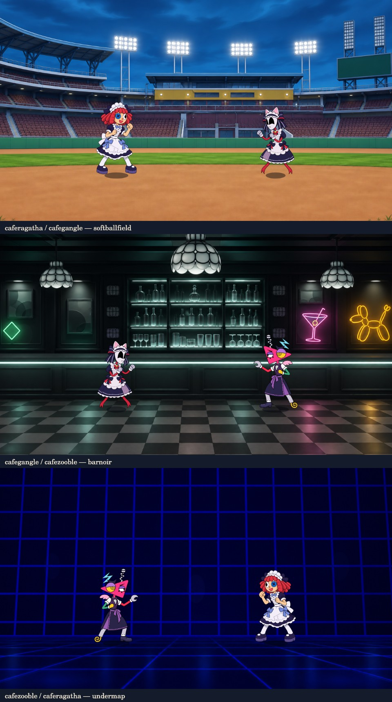

# Continuation C — trois familles Café

**Ragatha, Gangle et Zooble Café : 33 PNG natifs actifs, examinés puis intégrés.** Cette continuation du 20 novembre 2026 porte le catalogue à 480 costumes et les apparences Circus supplémentaires à 45 familles / 495 PNG. Le [bilan détaillé](../../COMBAT_CONTINUATION_C_2026-11-20.md) explique les références, les différences de tenues, les vérifications et les limites.

## Voir les nouveaux dessins

| Famille | Source et revue | Galerie dans le renderer |
| --- | --- | --- |
| Ragatha — Café | [Référence](cafe/reference-review-caferagatha.md) | [Actions et portrait](canvas/caferagatha/README.md) |
| Gangle — Café | [Référence](cafe/reference-review-cafegangle.md) | [Actions et portrait](canvas/cafegangle/README.md) |
| Zooble — Café | [Référence](cafe/reference-review-cafezooble.md) | [Actions et portrait](canvas/cafezooble/README.md) |

## Preuves finales

- [33 images, reçus et empreintes](cafe/asset-inventory.json) ; [déclaration de génération complète](cafe/generation-completion.json).
- [Intégration et conservation des 477 costumes](cafe/integration-proof.json) ; [point de départ indépendant](baseline.json) ; [revue indépendante du code et des copies](independent-integration-review.md).
- [432 tests et deux builds](qa-result.json) ; [journal complet](qa.log).
- [60 contrôles Canvas et trois portraits](canvas/canvas-review.json) ; [trois scènes et six gardes](canvas/scenes/scene-review.json).
- [Revue visuelle des galeries](canvas/visual-review.json) ; [seconde revue root](root-visual-review.json).
- [66 copies de PNG, 38 copies de modules et 5 830 fichiers historiques inchangés](build-integrity.json).
- [Vérification consolidée](verification.json) ; [compteurs runtime](runtime-counts.json).
- [Tentative navigateur et blocage avant navigation](browser-review/README.md).
- [Réconciliation du classeur](workbook/README.md) ; [travaux restants](remaining-work.md).

Les scripts de cette vague conservent les PNG natifs et produisent des diagnostics séparés. `cafe/integrate-native.py --check-only` vérifie les sources, reçus et copies. `scripts/verify-combat-continuation-20261120-c.py` relit les compteurs, l’intégrité et les preuves exécutées. Les commandes de rendu sont consignées dans le [dossier Canvas](canvas/README.md).

Les images sont des poses statiques originales du fan-game. Les contrôles Canvas utilisent les modules de production sous Node/Skia ; le navigateur local a échoué avant la création d’une page. Aucune animation complète, correspondance canonique 1:1 ou validation sur appareil physique n’est déclarée.
