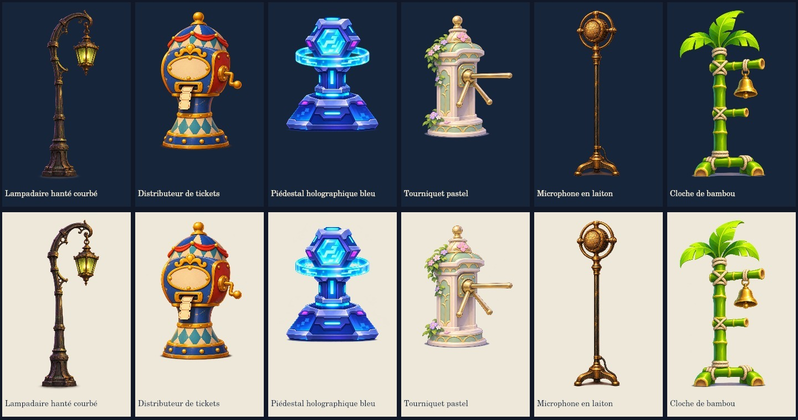
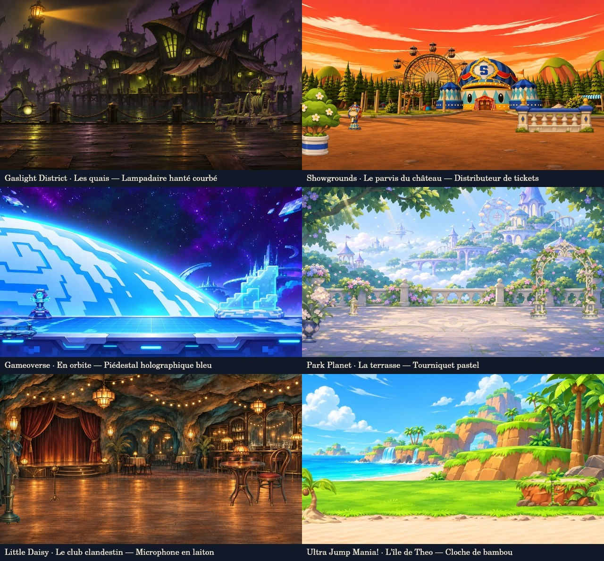

# Revue des six accessoires intégrés — 20 novembre 2026

Les six PNG proviennent de l’archive native récupérée le 19 novembre. Les copies
actives conservent exactement leurs octets, dimensions et transparence. Il n’y a
pas de génération d’image supplémentaire dans ce lot. Les planches JPEG ci-dessous
sont des documents de revue ; elles ne remplacent ni ne modifient les PNG du jeu.

- [Rapport d’intégration et résultats](../../COMBAT_PROPS_CONTINUATION_2026-11-20.md)
- [Inventaire source/destination, tailles et SHA-256](native-inventory.json)
- [Vérification de cette révision](verification.json)
- [Relevé Canvas final](review/canvas-review.json)
- [Relevé avant intégration](before/canvas-review.json)

## PNG natifs, fonds sombre et clair

La revue contrôle les silhouettes entières, les détails et la transparence.
Les chemins sources, identifiants de génération récupérés et limites de provenance
figurent dans l’[archive d’origine](../../../art/sources/recovered-local-props-20261119/README.md).

## Six décors intégrés

La planche présente les six compositions avec leurs accessoires. Les liens du
tableau donnent les comparaisons détaillées, avec l’état « avant » à gauche et
l’état intégré à droite. Les arènes sont rendues par le moteur de production avec
Canvas/Skia dans Node. Ce sont des aperçus du sélecteur de décors, sans combattant ;
ils ne constituent pas des captures d’un navigateur.

| Arène | Comparaison détaillée | Image finale |
| --- | --- | --- |
| Gaslight District · Les quais | [Avant/après](review/comparison-gaslightwharf.jpg) | [PNG](review/scene-gaslightwharf.png) |
| Showgrounds · Le parvis du château | [Avant/après](review/comparison-showgrounds.jpg) | [PNG](review/scene-showgrounds.png) |
| Gameoverse · En orbite | [Avant/après](review/comparison-gameoverse.jpg) | [PNG](review/scene-gameoverse.png) |
| Park Planet · La terrasse | [Avant/après](review/comparison-parkplanet.jpg) | [PNG](review/scene-parkplanet.png) |
| Little Daisy · Le club clandestin | [Avant/après](review/comparison-littledaisy.jpg) | [PNG](review/scene-littledaisy.png) |
| Ultra Jump Mania! · L’île de Theo | [Avant/après](review/comparison-simpleflipisland.jpg) | [PNG](review/scene-simpleflipisland.png) |

Le piédestal orbital a été abaissé de 18 pixels après inspection de son contact
avec la plate-forme. Son échelle et le fichier PNG restent inchangés. Les autres
placements reprennent les ancrages déjà présents dans le moteur.

## Portée des preuves

Le script vérifie six chargements et dessins effectifs, six scènes complètes et
dix-huit positions de caméra. Chaque PNG « avant » est authentifié contre son
rapport conservé avant d’être comparé. Les différences de pixels et leurs limites
sont enregistrées dans le rapport final. Les définitions des arènes sont également
contrôlées pour détecter une mutation involontaire.

Les 401 tests Node et les deux builds ont réussi. L’essai Chromium local a échoué
avant navigation en raison d’une interdiction de création de socket : **aucun
test navigateur de ce lot n’est déclaré réussi**. Les scénarios livrés couvrent
le chargement, l’échec, la récupération et le cache pour chacun des six accessoires.

La fidélité canonique des épisodes et l’animation des personnages restent hors
du périmètre de cette revue d’accessoires originaux.
