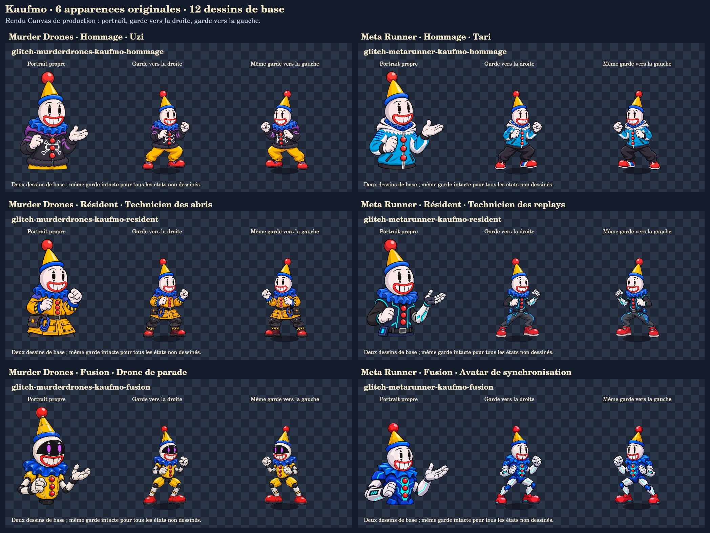
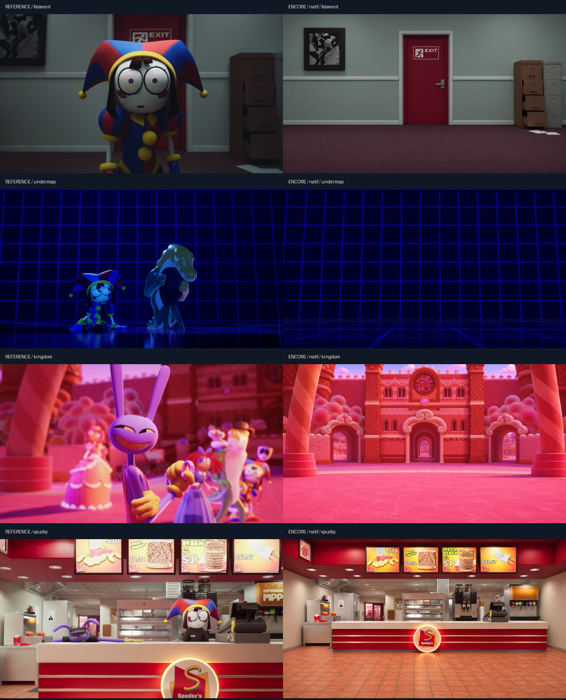
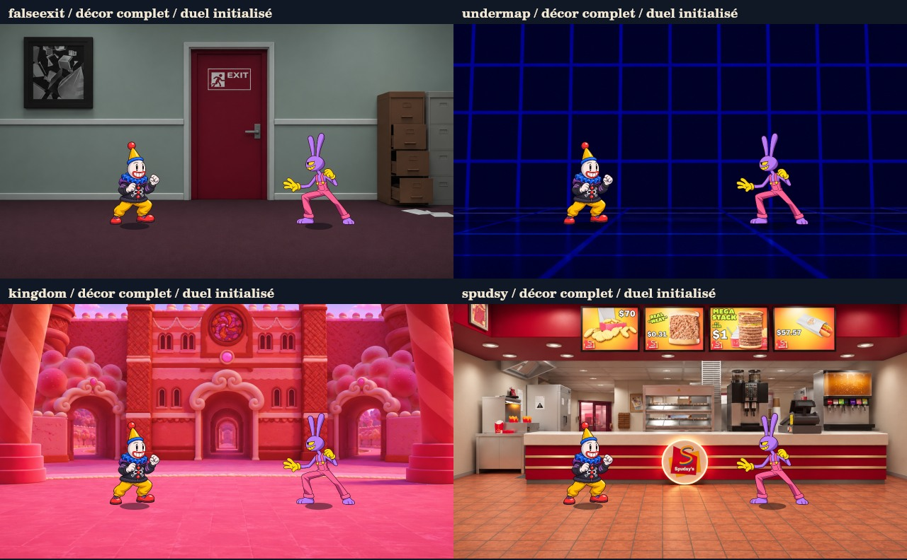

# Reprise du 27 novembre 2026 — bible étendue, Kaufmo et décors

Cette reprise part du commit publié `6e44ab75b9c82b4d6fe62a0051287275abc97753`,
sur la branche de la [PR 14](https://github.com/darknigthmare/CainOS/pull/14).
Elle ajoute **16 PNG actifs**, six apparences de Kaufmo et les deux extensions
du guide de combat. Les sources, leur intégration et les preuves de cette passe
sont conservées séparément des bilans historiques.

## Livraison de cette passe

| Ensemble | Résultat réel |
| --- | --- |
| Guide général | Déjà intégré ; original conservé et associations actualisées. |
| Deux extensions | Originaux exacts ajoutés ; 38 rubriques et 114 exigences adaptées à Encore. |
| Bible complète | 68 rubriques, 214 exigences ; 192 fiches de personnalité, 12 duos, 8 bonus et un hub de 5 salles conçus. |
| Kaufmo | 6 familles originales, 12 PNG natifs RGBA : sélection et garde séparées. |
| Décors | 4 PNG complets : bureaux EXIT, sous la carte, cour du royaume des bonbons, Spudsy’s. |
| Catalogue courant | 64 combattants, 640 techniques, 546 costumes, 438 crossovers, 27 arènes et 64 arrangements dédiés. |
| Hors ligne | 6 218 illustrations, 3 528 752 273 octets ; version `0.7.0-b6d11b136010`. |

Les systèmes de tag, nouvelles actions de menu, supers d’équipe, bonus, hub et
droits de soutien sont **documentés pour leur future implémentation**. Leurs
fiches ne constituent pas une livraison de ces mécaniques. Les trois modèles
de soutien restent désactivés ; l’accès gratuit au contenu existant demeure.
Les 40 scénarios d’acceptation des extensions ne sont pas comptés parmi les tests
moteur exécutés.

- [Index de la bible](../../bible/README.md)
- [Matrice des extensions et sources originales](../../bible/EXTENSIONS_COMBAT_INTEGRATION.md)
- [Validation documentaire et idempotence](../../bible/extensions-generator-verification.json)
- [Classeur de suivi](../../DIGITAL_CIRCUS_COMBAT_TRACKER.xlsx)

## Kaufmo : six apparences, douze dessins

Chaque image contient un seul personnage. Les trois traitements de chaque
univers sont distincts : vêtement d’hommage, résident original, fusion avec
transformation du corps. La garde native est réutilisée intacte pour les états
qui n’ont pas de dessin dédié. Aucun nouveau cycle d’animation ni pose d’action
supplémentaire n’est produit.

| Univers | Hommage | Résident | Fusion |
| --- | --- | --- | --- |
| Murder Drones | Uzi | Technicien des abris | Drone de parade |
| Meta Runner | Tari | Technicien des replays | Avatar de synchronisation |

Le [manifeste natif](kaufmo/manifest.json) décrit les douze fichiers, leurs
11 753 462 octets, SHA-256, dimensions, transparence, prompts et références.
Le [rapport artistique](kaufmo/README.md) explicite les repères d’identité et
la portée des créations. La [preuve Canvas](kaufmo/canvas/base-canvas-review.json)
et la [revue visuelle](kaufmo/canvas/manual-visual-review.md) portent sur ces six
familles seulement.

## Quatre lieux reconstruits

La comparaison conserve les sources officielles de GLITCH et Netflix, ainsi
qu’une copie d’image d’épisode sur un hébergement de distribution secondaire
pour les détails du comptoir. Le statut de chaque référence est indiqué dans
[sources.json](stages/sources.json). Les personnages présents dans ces images
ne sont pas peints dans les nouveaux fonds.

Les motifs caractéristiques restent visibles : murs gris-vert et porte EXIT,
grille bleu indigo sous la carte, piliers et ornements de sucre roses, comptoir
rouge et crème de Spudsy’s. Le cadrage de combat, la continuité du sol et les
parties initialement cachées sont des adaptations Encore. Les proportions
architecturales complètes ne sont pas certifiées 1:1.

Les quatre fichiers sont des PNG natifs **1672 × 941**, copiés sans réencodage.
Leur [inventaire](stage-files.json) et leurs [prompts](stage-prompts.json) sont
conservés. Le premier essai Spudsy’s est archivé comme candidat remplacé : son
sol était trop court ; une nouvelle génération de cadrage a fourni le PNG actif.

Chaque lieu utilise un fond complet, mis à l’échelle uniformément avec réserve
sur les bords pour un déplacement horizontal de six pixels. La ligne logique
des pieds reste à `y=568`. Sous la carte dispose d’un ancrage vertical mesuré
pour que la jonction mur/sol reste derrière les combattants. Les effets visuels
procéduraux associés aux anciens cadrages ne sont pas superposés aux nouvelles
peintures. Les 23 autres arènes et les 27 ambiances audio restent présentes.
Les fichiers historiques sont conservés comme repli.

Le compteur de requêtes de prévisualisation empêche une ancienne sélection,
chargée tardivement, de remplacer le dernier décor choisi. Un lancement de
combat invalide également les aperçus de menu encore en attente.

## Contrôles exécutés

| Contrôle | Résultat et portée |
| --- | --- |
| Tests Node | **473 / 473**, zéro échec, zéro ignoré ; quatre régressions du chargement et du cadrage incluses. |
| Syntaxe et contrats | **15 commandes réussies**, comprenant contrats CainOS et audit des guides. |
| Audit raster existant | 55 images, 304 références, 244 régions distinctes ; zéro violation technique. |
| Bases Kaufmo | **120 contrôles état/direction, 360 rendus**, 6 portraits ; mêmes sources et géométrie statique vérifiées. |
| Décors | **12 cadrages**, 4 duels initialisés, aucun bord transparent, peintures exactes et simulation inchangée. |
| Build autonome | **6 286 fichiers vérifiés**, dont les 6 218 illustrations, identiques aux sources par SHA-256 et octets. |
| Build CainOS | **6 290 fichiers vérifiés**, dont les 6 218 illustrations, identiques aux sources. |
| Bible | Trois originaux exacts ; 20 sorties contrôlées sans changement SHA/mtime ; 287 liens locaux valides. |
| Classeur | 14 feuilles, 38 sections et 254 fiches ajoutées ; 42 formules sans erreur et 22 aperçus relus. |

Le [rapport du classeur](../../combat-extensions-workbook-verification.json)
compare 93 392 cellules historiques, avec 108 modifications déclarées et aucune
différence non autorisée. Les identifiants, notes, styles et formules sont
conservés. Ses 3 937 lignes Production et 2 527 lignes QA distinguent les
propositions des extensions, les images réellement livrées et les contrôles
exécutés. Les 70 empreintes de sources et de preuves ont été revérifiées après
publication locale du fichier.

Les [preuves techniques finales](verification-final.json) relient les journaux,
rapports et empreintes. Les builds ont été produits séparément, puis leurs copies
temporaires supprimées après comparaison intégrale ; les sources reproductibles
et rapports restent conservés.

Les [540 costumes historiques](catalog-preservation.json), les 64 définitions de
combattants et les 27 identités d’arènes sont inchangés et dans le même ordre.
Les [6 206 fichiers d’assets antérieurs](baseline-assets-preserved.json) ont été
comparés à leurs objets Git de la base publiée, sans différence.

### Limite de la campagne navigateur

Aucune assertion navigateur locale n’a pu s’exécuter : le binaire Chromium
est absent et son téléchargement a répondu HTTP 403. Les suites de garde-robe
et de décors ont été corrigées, revues et contrôlées syntaxiquement. Le workflow
de la PR garde tous ses critères et doit vérifier le commit publié. Cette passe
ne déclare ni succès navigateur actuel, ni revue physique complète.

Le précédent workflow avait lancé 21 suites ; 464 contrôles avaient réussi dans
les autres suites, mais la suite de fusion échouait avant son premier contrôle
réussi sur une ancienne attente de garde-robe de Queenie. Cette attente est
maintenant alignée sur ses 27 crossovers réellement publiés. Les chiffres de
cette ancienne exécution ne sont pas présentés comme des résultats actuels.

## Travail antérieur non retrouvé et suite

Les sources des **79 PNG précédemment annoncés mais non publiés** n’ont pas été
retrouvées dans le dépôt, les fichiers accessibles ou les archives recherchées.
Le [rapport de récupération](recovery.json) conserve les recherches et leur
résultat. Cela ne prouve pas que les générations n’ont jamais eu lieu ; leurs
octets ne sont simplement pas disponibles pour une intégration vérifiable.

Les seize PNG de cette livraison sont de **nouvelles productions documentées**,
et non ces fichiers anciens prétendument récupérés. Le [registre de suite](remaining-work.md)
sépare les bases encore à produire, les futures mécaniques des extensions et
les validations artistiques/navigateur restantes.

Les références officielles servent à contrôler l’identité ; les croisements
d’univers, récits, gestes conçus et cadrages de combat sont identifiés comme
créations Encore. Aucune certification canonique générale 1:1 n’est déduite des
tests techniques.
