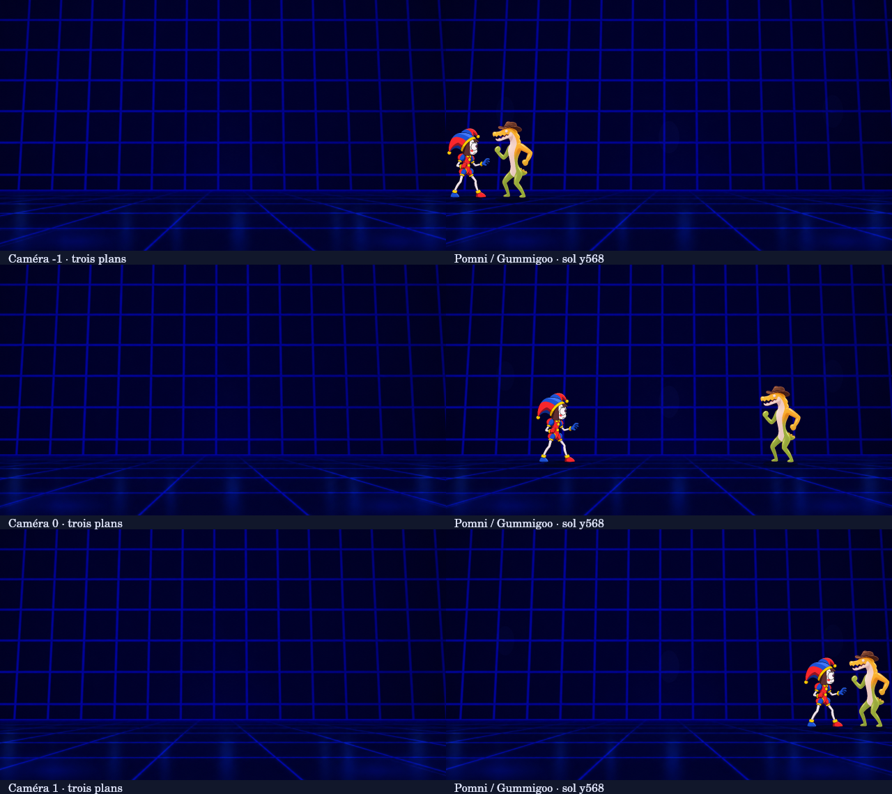

# Sous la carte — nouveau décor du 20 novembre 2026

**Un lieu réellement absent devient une arène complète : `undermap`, l’espace bleu quadrillé sous Candy Canyon.** Le catalogue passe de 22 à 23 arènes partagées. Les 54 arrangements dédiés continuent de réutiliser les décors existants.

## Pourquoi ce décor

L’[inventaire avant ajout](existing-stage-inventory.json) retrouve les **66 plans des 22 arènes**, sans fichier manquant. Les treize anciennes lignes partielles d’alignement sol/pieds/ombres restent des travaux de revue. Elles ne représentaient pas treize décors absents. Les 54 scènes dédiées réemploient les fonds partagés.

`undermap` n’apparaissait ni dans ces 22 IDs ni dans leurs thèmes réemployés. La fiche du Vide distinguait déjà cet espace quadrillé du lieu blanc du pilote. La salle de calibration est, elle, une création utilitaire du jeu. Leurs références ne permettent pas de les assimiler à la salle de l’épisode 2.

La [galerie officielle GLITCH](https://www.glitchprod.com/digital-circus), lien d’image 29, publie le [visuel primaire de Pomni et Gummigoo sous la carte](https://static.wixstatic.com/media/84ed6a_0558e3b65a3146b5b04b7828da5b4d0e~mv2.png). L’[original conservé](references/glitch-undermap-official.png) mesure 3840 × 2160 et a été inspecté : paroi indigo quadrillée de bleu, sol réfléchissant, palette cobalt. La [preuve de provenance](reference-publication-proof.json) précise les méthodes de récupération et leurs limites.

Cette seule image sert de repère pour la palette, les motifs et la matière. La largeur du ring, sa ligne horizontale, la séparation en plans et les reflets ajoutés sont des adaptations d’Encore. Aucun visionnage complet d’épisode ni plan coté du lieu n’est revendiqué.

## Trois plans natifs

| Plan | Composition | Dimensions reçues | Octets |
| --- | --- | --- | ---: |
| [far](native/far.png) | Paroi quadrillée, fond opaque | 1672 × 941 | 1 163 294 |
| [mid](native/mid.png) | Sol en perspective, alpha natif au-dessus | 1672 × 941 | 464 706 |
| [near](native/near.png) | Reflets bleus discrets aux coins inférieurs | 1672 × 941 | 193 031 |
| **Total** | **3 PNG distincts** | | **1 821 031** |

Chaque plan a été produit par un appel séparé à l’outil intégré `image_gen.imagegen`. Les [prompts](generation-prompts.json), [reçus](generation-receipts.json) et [empreintes](asset-inventory.json) sont conservés. Le premier prompt demandait 3840 × 2160 ; le service a livré 1672 × 941. Les fichiers ne sont donc pas décrits comme des sorties 4K. Les deux autres appels ont demandé le même format natif. Aucune mise à l’échelle de fichier, retouche de pixels, conversion ou normalisation d’alpha n’a été appliquée.

Les copies actives sont identiques aux sources, sous `assets/encore/stages/undermap/{far,mid,near}.png`. Le chargeur existant conserve son canevas logique 1280 × 720, son sol à y568, son débord de 32 pixels et ses déplacements de 6/17/31 pixels. Il n’a pas été modifié.

## Intégration et sauvegardes historiques

L’ID est ajouté après les 22 arènes existantes. Sa fiche relie `ep2` et la source déjà présente `glitch-undermap`. Un thème musical, une ambiance sonore et une faible pulsation visuelle originaux accompagnent le décor. L’ambiance reste derrière les personnages, au-dessus du sol, et se fige avec les mouvements réduits. Un repli procédural indigo quadrillé évite de substituer le cirque lorsque les images sont indisponibles.

Deux dépendances à la longueur du catalogue ont été corrigées avant livraison :

- Les quarante routes PNJ utilisent désormais la liste explicite des 22 scènes sur lesquelles leurs chapitres et leurs tableaux ont été écrits. Les quatorze routes initiales restent inchangées.
- Le validateur de programmes v1 reconnaît le catalogue publié de 54 combattants / 22 arènes. Il préserve le contexte d’origine lors de la continuation et des reprises après défaite. Les contextes plus anciens à 12/21 arènes et leurs règles de tournoi sont conservés. Les nouveaux programmes peuvent tirer ou sélectionner `undermap`.

Les [fixtures indépendantes](../../../tests/fixtures/combat-pre-undermap.json) ont été capturées **avant l’édition**, avec comparaison des modules aux octets du commit local `3858f03` : **54 récits complets**, **45 programmes / 270 checkpoints**, et **14 replays / 3 682 frames**. Leur [preuve de capture](before-addition-proof.json) fige les empreintes. Elles ne sont pas régénérées depuis l’implémentation ajoutant la nouvelle arène. Les IDs historiques, l’ordre initial des stages, le moteur, les formats et les versions de sauvegarde restent stables.

## Vérifications

Les [80 tests ciblés](targeted-tests.log) passent sans échec : contenu des récits, imports de programmes, profils, continuation, défaite/reprise, fin des parcours, replays, catalogues antérieurs, audio et mouvement des arènes. Les nouveaux programmes avec `undermap` sont acceptés ; les calendriers importés arbitraires restent rejetés.

La [QA globale finale](../cast-next-missing-20261120/qa-result.json), exécutée après les quatre familles de costumes de ce lot, valide **411 tests sur 411, zéro échec, et les deux builds**. La [vérification consolidée du niveau](verification.json) rattache ces résultats aux empreintes des sources gelées.

Le [script de revue](../../../scripts/review-combat-undermap-20261120.mjs) utilise le **vrai chargeur des trois plans et le moteur Canvas de production**, sous Node/Skia. La [revue enregistrée](review/canvas-review.json) compte six contrôles : fichiers réellement lus, repli distinct, trois caméras sans trou transparent, caméra figée en mouvements réduits, animation sans changement des pixels du sol, et données non modifiées par le rendu. Trois vues de décor et trois scènes avec Pomni/Gummigoo sont conservées.



La revue visuelle vérifie les lignes de sol, l’espace de combat dégagé, les bords, la cohérence des bleus et les reflets discrets aux trois positions. Les personnages sont ceux déjà publiés ; cette passe ne revalide pas leur fidélité anatomique. Le repli est visible dans [fallback.png](review/fallback.png).

La revue a été réexécutée après la QA globale sur le manifeste final **`0.7.0-cdc85685a728`**, empreinte artistique **`cb628ae846008788`** : **5 769 images / 3 059 080 660 octets**. Les six captures de caméra et de scène, ainsi que la planche et le repli inspectés, sont identiques octet pour octet aux images acceptées. Les six contrôles passent de nouveau ; la [revue visuelle](visual-review.json) conserve cette preuve de rafraîchissement.

Ces preuves Canvas ne constituent pas un contrôle du navigateur, des entrées, de l’audio audible, du service worker ou d’un appareil physique. Le [relevé CI](ci-state.json) concerne le parent distant `3bd83cdf` : contrats, tests Node et deux builds réussis ; étape navigateur encore en cours. Aucun échec concret observé, aucune relance effectuée. Les contrôles du futur commit global seront rattachés à leur propre SHA.

Le niveau, ses sources et ses preuves sont finalisés sur ce manifeste. Le classeur et le commit global restent gérés dans la réconciliation du lot. La publication GitHub attend le commit global ; aucun merge ni commentaire externe n’a été effectué dans cette passe.

## Reproduire la revue

Après génération du manifeste contenant les trois PNG :

```sh
node --test tests/combat-undermap.test.mjs tests/combat-program-compatibility.test.mjs tests/combat-progression.test.mjs tests/combat-audio.test.mjs tests/combat-audio-ambiences.test.mjs tests/combat-render-sequences.test.mjs
node --expose-gc scripts/review-combat-undermap-20261120.mjs
```

Le script de rendu enregistre les empreintes des modules et du manifeste. La revue finale ci-dessus a déjà été réexécutée après leur gel. Une nouvelle modification de ces sources nécessiterait une autre revue.
