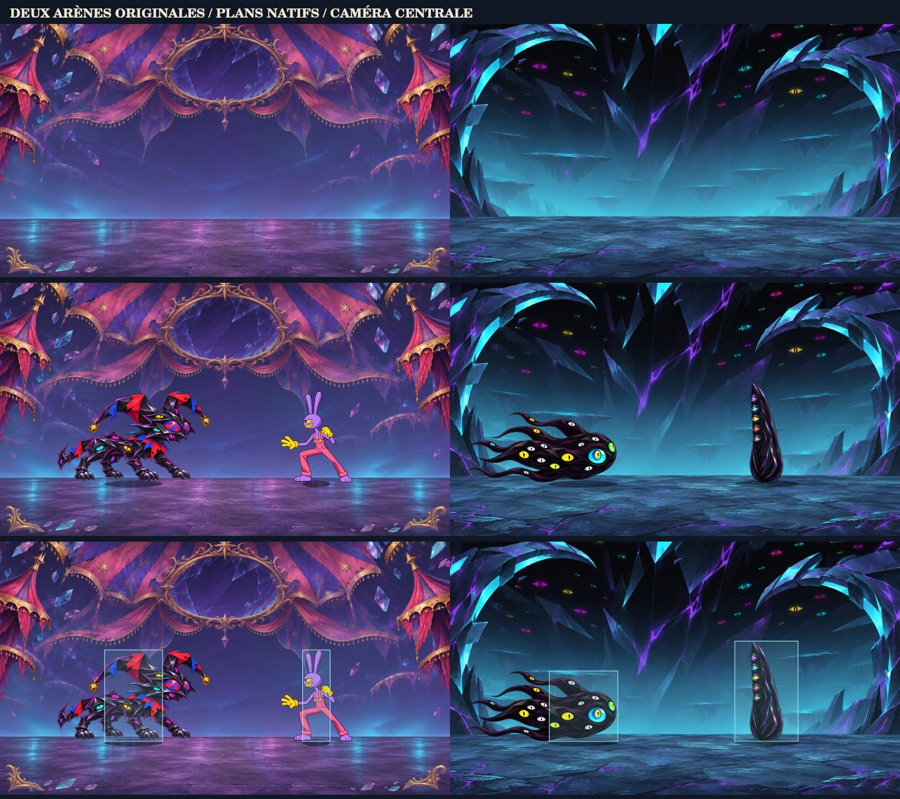

# Encore — abstractions, projectiles et deux arènes originales
## Lot du 24 novembre 2026

Cette continuation ajoute **dix combattants abstraits**, une apparence calme pour
Queenie, **quinze motifs de projectile** et **deux arènes originales** au moteur
partagé par CainOS et le jeu autonome. Les anciens programmes, les anciennes
apparences et les règles de replay restent préservés.

Le contenu de jeu et les dessins sont inventoriés séparément de leur statut de
référence. **La fidélité canonique ou pixel par pixel 1:1 n'est pas certifiée.**
Une identité confirmée dans une source ne certifie pas le modèle de jeu ni ses
poses ; les formes originales sont identifiées comme telles.

| Catalogue courant | Total |
| --- | ---: |
| Combattants / techniques | 64 / 640 |
| Arènes partagées / arrangements dédiés | 27 / 64 |
| Costumes sélectionnables / entrées d'archive | 484 / 184 |
| Routes / tableaux narratifs | 64 / 384 |
| Finales / numéros d'amitié / séquences de présentation | 192 / 64 / 320 |

## 1. Combattants et apparences

| Combattant ajouté | Rôle | Statut de référence |
| --- | --- | --- |
| Abstraction du cellier | Colosse | Attribution de l'archive CainOS à confirmer |
| Abstraction aquatique | Contrôle | Attribution de l'archive CainOS à confirmer |
| Jax — abstraction | Assaut | Identité attribuée à une source officielle ; comparaison visuelle ouverte |
| Queenie — abstraction | Défense | Identité officielle ; comparaison visuelle ouverte |
| Ribbit — abstraction | Mobilité | Attribution de l'archive CainOS à confirmer |
| Pomni — abstraction originale | Mobilité | Création originale Encore |
| Ragatha — abstraction originale | Contrôle | Création originale Encore |
| Gangle — abstraction originale | Distance | Création originale Encore |
| Kinger — abstraction originale | Colosse | Création originale Encore |
| Zooble — abstraction originale | Polyvalence | Création originale Encore |

Chaque identité possède son corps de simulation et ses dix techniques, soit
**100 techniques supplémentaires**. L'état calme de Queenie utilise les mêmes
statistiques, collisions et techniques que Queenie abstraite ; il est compté
comme un costume, pas comme un onzième combattant.

Les dix identités et Queenie calme forment **onze apparences × onze dessins =
121 PNG** : portrait, garde, introduction, attaque, coup lourd, impact, marche,
saut, accroupissement, victoire et défaite. Six portraits publiés sont conservés
à l'octet près ; les 115 autres dessins sont des ajouts natifs. Les tenues
d'abstraction partielle déjà présentes restent séparées de ces nouvelles identités.

Les [planches de personnages](art-generation/abstractions-20261124/canvas/characters/README.md)
et la [revue de Queenie calme](art-generation/abstractions-20261124/calm-asset-review.json)
documentent la continuité des dessins et leur cadrage. Les cinq formes
[originales](art-generation/abstractions-20261124/originals/README.md) disposent
de silhouettes propres : grelots de Pomni, coutures et bouton de Ragatha, rubans
et fragments de masque de Gangle, couronne et tour de Kinger, pièces asymétriques
de Zooble.

### Taille et ancrage des poses

Les onze apparences disposent d'un plafond de largeur propre, appliqué par une
réduction uniforme autour de leur ancre. Cette correction concerne 27 actions
horizontales et conserve leurs proportions. Cinq réglages de hauteur complètent
la calibration : introduction, impact, victoire et coup lourd de Pomni originale,
puis coup lourd de Ragatha originale. Ils s'appliquent uniquement au dessin
d'action effectivement chargé. La garde de remplacement conserve sa taille.

La comparaison des yeux de Pomni et du bouton de Ragatha a servi de repère entre
les poses. Les deux planches finales ont été relues après intégration. Ces
ajustements de présentation ne modifient ni les PNG, ni les collisions, ni les
techniques, ni la présentation des 54 combattants historiques. Voir les
[mesures et décisions de calibration](art-generation/abstractions-20261124/canvas/width-calibration.md).

### Récits et présentation

Les dix ajouts reçoivent dix routes et **60 tableaux narratifs**, **30 finales de
spectacle**, dix numéros d'amitié, dix arrangements dédiés et cinquante séquences
de présentation. Le catalogue complet atteint donc **64 routes / 384 tableaux,
192 finales, 64 amitiés et 320 séquences de présentation**.

Les récits ne donnent pas de guérison, de nouvelle fin officielle ou de dialogue
canonique aux abstractions. Les cinq formes originales sont des projections de
simulation propres à Encore.

## 2. Projectiles

Les quinze motifs sont : balle de jonglage, clé, bouton, masque de comédie, module
de Zooble, pièce d'échecs, confettis, bulle, confiserie crocodile, éclat de sucre,
Gloink, Fudge, corruption, projectile spectral et boîte à farce.

Le catalogue couvre les **73 techniques à projectile** présentes dans les 64
kits. Certains motifs sont partagés explicitement : les quarante PNJ historiques
utilisent onze de ces motifs, sans copie cachée d'une nouvelle illustration par
technique. Le renderer utilise l'image réellement chargée et la retourne avec
la direction du tir, y compris après un renvoi. La boîte à farce conserve son
statut non réfléchissable.

Le cache conserve au plus huit textures réduites pour le rendu, avec deux
décodages simultanés, délai d'abandon et possibilité de réessai. Les fichiers PNG
natifs du dépôt restent inchangés. L'origine des tirs de l'abstraction aquatique
est ancrée devant la tête dans les deux directions ; les tendrilles ne gonflent
pas sa collision.

Voir la [planche des quinze motifs](art-generation/abstractions-20261124/canvas/projectiles/projectiles-native-and-reflected.png)
et le [rapport des tirs et renvois](art-generation/abstractions-20261124/canvas/projectiles/projectile-canvas-review.json).

## 3. Arènes originales

| Arène | Intention visuelle | Livraison |
| --- | --- | --- |
| Le chapiteau des souvenirs brisés (`memoryfracture`) | Chapiteau violet, miroirs et fragments de mémoire, piste centrale libre | Trois plans natifs, thème musical, ambiance sonore et mouvement de fond |
| Le seuil de l'abstraction (`abstractionthreshold`) | Faille sombre aux reflets cyan, arches et regards périphériques | Trois plans natifs, thème musical, ambiance sonore et mouvement de fond |

Les deux lieux sont des créations Encore. Les six plans utilisent le chargeur,
la caméra et la parallaxe de production. Le mode mouvements réduits fige les
effets d'ambiance. Les thèmes et sons sont des compositions procédurales
originales ; aucune musique officielle supplémentaire n'est revendiquée.

Le [rapport des décors](art-generation/abstractions-20261124/canvas/stages/stage-canvas-review.json)
distingue les six compositions de caméra des quatre captures de deux duels
initialisés. Ces captures ne sont pas des matchs joués dans un navigateur.

## 4. Ribbit × Sunset Paradise

Le [lot complémentaire](art-generation/sunsetparadise-ribbit-20261124/README.md)
fournit trois créations originales : **Hommage à Meggy**, **Résidente de Port
Aurora** et **Fusion amphibienne**. L'hommage et la résidente conservent la
morphologie longue de Ribbit ; la fusion redessine un corps turquoise compact,
avec nageoires orange et branchies roses.

Chaque style possède onze dessins natifs, soit **33 PNG supplémentaires**.
Les trois styles ont été activés après vérification de leur inventaire natif
complet et comparaison des empreintes. Il s'agit de nouvelles créations de reprise,
pas d'une affirmation de récupération à l'identique d'anciens fichiers perdus.

## 5. Préservation et vérification

Le contrôle des assets antérieurs a comparé **5 911 fichiers suivis**, dont
**5 863 fichiers Encore**, au SHA Git de l'index publié : **3 222 004 686 octets
préservés, zéro différence**. Les copies de preuve historiques nécessaires aux
tests de scènes sont également identiques aux images déjà publiées.

Les tests de compatibilité séparent les programmes historiques des nouveaux
catalogues. Le socle des 54 combattants et les 480 costumes antérieurs gardent
leur contenu et leur ordre. La fixture de reprise contient 77 programmes et
385 checkpoints reconstruits depuis le socle publié resté inchangé ; elle
n'est pas présentée comme une fixture sauvée avant la perte de l'environnement.

L'[inventaire principal](art-generation/abstractions-20261124/asset-inventory.json)
couvre **142 fichiers / 130 766 467 octets** : 121 personnages, quinze projectiles
et six plans. Les 33 Sunset sont contrôlés dans leur inventaire séparé. Les
sorties sont copiées sans recadrage, recoloriage ou réencodage des PNG.

L'[inventaire combiné](art-generation/abstractions-20261124/delivery-assets.json)
réunit **175 chemins distincts / 156 157 497 octets**, avec 175 empreintes
différentes : **169 ajouts natifs et six portraits publiés réutilisés**.

### Vérification exécutée sur les sources finales

| Contrôle | Résultat |
| --- | --- |
| Suite Node complète | **461 tests réussis, zéro échec, zéro test ignoré** |
| Build autonome | **6 147 fichiers vérifiés par SHA-256**, dont 6 082 illustrations, 63 fichiers du jeu et deux fichiers d'entrée ; zéro différence |
| Build CainOS | **6 151 fichiers vérifiés par SHA-256**, dont les mêmes illustrations et fichiers du jeu, plus six fichiers d'entrée ; zéro différence |
| Abstractions sous Canvas natif | 121 fichiers ; 220 contrôles de dessin et d'ancre ; aucune absence ni action réutilisée |
| Ribbit × Sunset sous Canvas natif | 33 fichiers ; 60 contrôles de dessin ; aucune absence ni action réutilisée |
| Projectiles sous Canvas natif | 30 tirs simulés, 28 renvois réels, 58 contrôles de dessin et deux contrôles de départ aquatique |
| Arènes sous Canvas natif | Six plans, six compositions de caméra, deux duels initialisés et quatre captures |

Le [bilan vérifiable](art-generation/abstractions-20261124/verification.json)
lie ces résultats aux empreintes des sources et des rapports. Le manifeste
hors ligne est **`0.7.0-a75401ab15c4`**, sa version d'art
**`0a23b46977da5002`** : **6 082 illustrations / 3 372 101 559 octets**.
Les deux builds ont été construits séparément et comparés aux fichiers sources.

La première passe globale avait révélé des preuves historiques absentes de la
copie locale et trois attentes restées sur l'ancien catalogue. Les **253 PNG
de preuve ont été restaurés à leur empreinte publiée** et les assertions de
catalogue ont été actualisées. Le premier résultat, les corrections ciblées et
la passe finale sont conservés séparément ; aucun échec initial n'est présenté
comme une réussite.

### Classeur de production

Le [classeur courant](DIGITAL_CIRCUS_COMBAT_TRACKER.xlsx) et son
[rapport de publication](art-generation/abstractions-20261124/workbook/README.md)
intègrent le lot et ses preuves : **onze feuilles, dix tableaux filtrables,
106 fonctionnalités, 3 739 tâches de production, 408 scénarios, 2 499 lignes QA
et 170 sources**. Les lignes QA regroupent des campagnes et objectifs datés ;
elles ne représentent pas 2 499 tests indépendants exécutés dans cette passe.

La réimportation compare **90 882 cellules sans écart** et les dix tableaux au
JSON compagnon. Les **42 formules** ont été recalculées, avec un changement de
statut réversible pour vérifier les totaux. Les **76 aperçus finaux** ont été
relus. Le périmètre historique de 83 423 cellules a été contraint avant édition ;
160 mises à jour prévues ajustent les champs dépendant du catalogue, tout en
conservant les identifiants, l'ordre et les notes. Les 395 nouvelles tâches de
production sont ajoutées après le socle.

L'export XLSX porte le SHA-256
`d6c042f01697a21ab8b6144ecd6220e56ab95c63a4d0808f38589b1dc051e9da`.
La relecture et les empreintes sont détaillées dans le
[rapport du classeur](art-generation/abstractions-20261124/workbook/workbook-review.json).
Après son installation, les cinq suites concernées par les formats du suivi,
la publication, les preuves de livraison et l'ordre des costumes ont de nouveau
passé **32 tests sur 32**, consignés dans un
[résultat post-export distinct](art-generation/abstractions-20261124/workbook/post-export-tests.json).

## 6. Fidélité et suite

Les onze dessins par apparence sont des états statiques. Le moteur anime des
transitions et effets autour d'eux ; les cycles dessinés image par image restent
à produire. Les éléments masqués, proportions et attributions d'archive exigent
encore des comparaisons primaires identifiées.

La tentative Chromium locale s'est arrêtée sur un refus de socket avant de
créer une page : **zéro assertion navigateur exécutée**. Les rapports Canvas
sous Node/Skia ne constituent pas des essais DOM, clavier, tactile, manette,
lecture audio ou service worker. Les résultats distants éventuels sont
rattachés au SHA de la PR ; les essais physiques restent ouverts.

Le [registre des travaux ouverts](art-generation/abstractions-20261124/remaining-work.md)
conserve les comparaisons canoniques, animations, garde-robes et candidats encore
insuffisamment documentés. Les preuves du présent lot ne remplacent pas celles
des versions antérieures et ne clôturent pas une fidélité globale 1:1.

